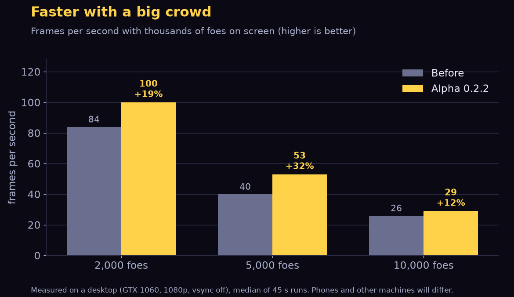
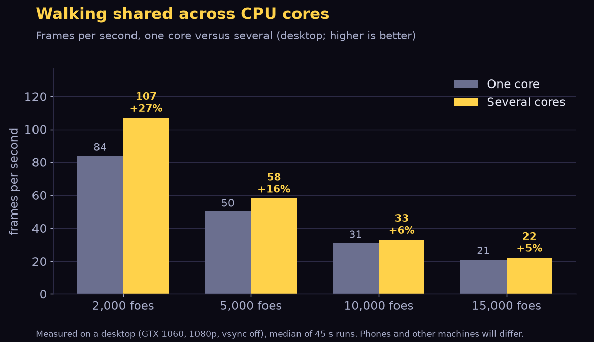
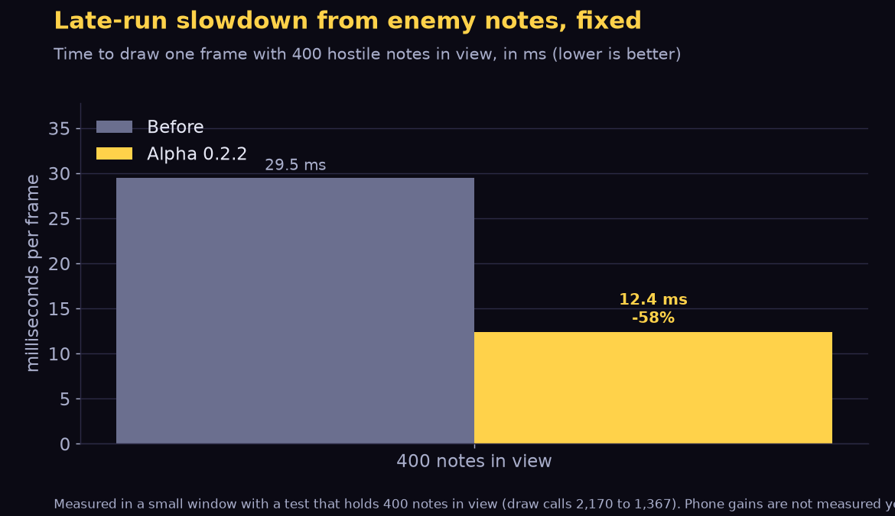

# The Last Bard: Alpha 0.2.2
*A browser build that stays smooth, weapons that can all evolve, a one-piece armory mannequin, companions with their own cards, and a lot more to ask Maestra.*

## New
- **Every weapon can evolve.** Eleven new twin fusions join the six old ones, so none of the fifteen base weapons is left out. A twin fusion is two real weapons fighting as one, each firing a little faster and a little weaker: **Hurricane Fanfare** (Rally Horn + Chain Spark), **Siren's Refrain** (Ballad + Sheet Music), **Prism Harp** (Harp of Light + Ember Bolt), **Duelist's Score**, **Brass Bolts**, **Pyre Arrows**, **Arc Repeater**, **Brass Thunder** (Cymbal Crash + War Drum), **Duelist's Duet**, **Grand Lyre** (the lute and the harp) and **Storm Choir**. Each has a two-part icon, and the Unlocks menu previews it.
- **Kage has boosts of his own:** **Whetted Edge** (his cuts hit 20% harder and reach wider) and **Second Cut** (a chance for an extra cut on each stroke). They appear once you have found him, like Rowan's and Morwen's.
- **Companion offer cards** now tell you what each companion does. The go-alone card is **Lone Wolf**: +20 max health (with a little heart), healed at once, and it goes the moment you take a companion. All your companions wait for you back at camp.
- **Maestra Orsolya has a great deal more to say.** Ask her about the Silence, the Closer, the husks, the castle, Oakhaven, the Resonant Stone, the little animals and the old treasures. Kage, Rowan and Morwen have more to tell too.

## Changes
- **The armory is one mannequin** that wears your cape, helm, breastplate and greaves, each in the colour of the best piece you own for that slot. A piece you have not found leaves that part bare. The relic and charm stands stay beside it.
- **Synergy strings** in the Unlocks menu always flow from the boost to the weapon it boosts, whichever of the two is highlighted.
- **Power-ups no longer interfere:** picking up a new one never shortens one that is still running.
- **Reprieves stay busy for a bard with the whole Fountain.** The gap between songs now counts how much of the Fountain you own, not just what you spent, so a fully upgraded bard keeps a real crowd to fight.

## Camp, strings and phones (from Oct 25)
**Camp**
- **A card book** stands beside the Collection rack: an album whose card slots fill as you find weapon and boost cards, with loose cards leaning on it from half full and a golden glow when it is complete. Same station and menu as the rack.
- The Resonant Stone moved to the camp's north-west, away from the armory.

**Cards, strings and HUD**
- **Strings by music family.** The LEVEL UP banner now lights two strings (one off each end) that carry notes in the highlighted card's family style: eighth notes for Strings, curls for Wind, square hits for Percussion, slashes for Blades, arrowheads for Bows, sparks for Spells, open notes for Voice. The Unlocks menu, the in-run HUD and the pause menu's build page use the same styles.
- The gear callout on treasure picks lights up when you hover anywhere on it; only its **Equip** button equips. The Collection keeps the highlighted tile when you wear a piece.
- More room between the level-up cards, so the lifted card's border no longer touches its neighbours.
- **The HUD shows only what you carry.** You start with just the lute; each new weapon or boost pops a slot in, and the card flies to where it will appear.
- **PLAY, START RUN, SET OUT, Resume and Revive share one look**: a soft golden glow, and music notes rise off the button while it is highlighted. The title screen's highlighted entry turns magenta, and a desktop **EXIT GAME** sits right under Settings.
- Cymbal Crash cymbals now drift onto the foe they were dropped on, so they always land. Final Flourish says "cooldown". Every line that names the action key (the Resonant Stone's unlock, loading tips, the key test) now shows the key you chose in Settings.

**Foes and pacing**
- Staccato first appears at 3:00 (was 2:00).
- Once you have the cape, no gold Husk shows up before 2:30, the cape's Husk walks in alone, and the Resonant Stone only turns up in a run that started with the cape already found.
- Stumps no longer block the bard.

**Phones and browsers**
- **Walking is smooth on iPhone**: the camera now follows the bard exactly, and movement steps are evened out on Safari's rounded clock. The bard no longer keeps walking after you pick a card.
- Starting a run from the camp no longer redraws the game's art sheets (less memory at the tightest moment, and a faster start). Render buffers are smaller too.
- Fixed the floor going black far from the start, and the floor glow repeating in tiles.
- The browser game now **updates itself**: on the title screen it checks for a newer version and reloads into it. The page shows its build time on the title screen.
- A new app icon, a gold lute with a rose ribbon. On an iPhone, fullscreen is only possible by adding the game to your Home Screen (the Settings button now says so).
- Big hordes cost a little less to simulate everywhere (about 7% at 5,000 foes).
- **No more brief freezes on Safari and phones.** Walking (especially round the Sanctuary) no longer hitches every 10 to 15 seconds: a hidden full-screen effect was being drawn every frame, and some note trails were redrawn for nothing. Together with the earlier fixes, a 5-minute test now shows about one hitch where there were a dozen.
- The Second Verse page in the Unlocks menu now lists every weapon it adds a projectile to (locked ones stay ???). The weapon barrel by the armory can be walked through, and the stray extra weapon racks are gone.

## Companions, endless cards and pop-ups (Oct 25 night)
- **Choose your companion.** When you find Kage, Rowan or Morwen in a run, they no longer pop up beside their own copy: they finish speaking, leave the scene, and then a card offers you the choice: **take them** (replacing anyone already with you), **keep who you have**, or **go alone**.
- **Endless cards** are now **Endless Whetstone**, **Endless Quick Tempo** and **Endless Second Wind**. Take the same one **three times in all** (not three in a row) and every level-up and chest takes it for you, with a callout when it locks in. The cards say so.
- Bats first show up at 1:30 (after the cape's gold Husk), not at 1:00.
- The gear callout on a treasure pick now flies away to the health and XP bars with the cards, as if it were a fourth card.
- On the death screen and the pause build page only one hover pop-up shows at a time, and pop-ups sit above the synergy strings.
- Companion answers in camp ("Walk beside me", "Hold the camp") stay on screen instead of being wiped at once.

## Oct 26 additions
**Songs**
- **The soundtrack opens with the Magic Harp.** Once you have found the harp, torn sheet music can turn up (rarely) in chests, even together with a piece of gear: the page flows out of the chest and settles under the gear, and a small badge on the right reports "Soundtrack 1/3" once the cards appear. Each page unlocks one more song, and there are now **seven** to find: four new ones, **Bramble Bash** (a forest romp), **Dune Tavern Brawl**, **Anthem of the Last Lantern** and **Stompwood Run** (one relentless groove, heavy on the bass). The harp's menu shows how many you have found and lists the locked ones as padlocked "???", the Collection has a new **Songs** page, and Settings has a **Song** dropdown, so you can change the song from any menu. (Before the harp is found the song still changes now and then after a run.)

**Listen mode (desktop Linux and Android)**
- **YOUR MUSIC: ON / OFF** on the title screen (desktop Linux and Android, while it is still experimental only with the developer controls on; Settings always has the switch) is the switch for this: on, the title theme stops and the game follows what you are playing; off, the soundtrack comes back.
- **Follow the sound of your device** instead of a song: turn on "Follow the sound of this PC / phone" in Settings and the game takes its beat from whatever Spotify, a browser or any player is playing (pick which app, or whatever is playing). It never uses the microphone, and nothing is recorded or sent. On Android it needs the app (Android asks for permission once).

**Pets, the Stone and the cape**
- Finding **Pip** now says more pets can be earned, and a second wild Pip no longer stands in the world after he has joined you (one that was already generated disappears when you find him).
- The **Resonant Stone** stays where it stands, cold and dull, when you take its power: its glow flies up to the ability slot, which pops open.
- The **Tattered Cloak**'s text explains its gauge (health or level progress; change it in Settings).

**Balance and pacing**
- **Pan Flute** starts with two notes instead of one.
- The first **bats** wait until the cape's gold Husk has been out for 20 seconds (or has fallen), so the two no longer arrive together.

**Camp and menus**
- A bobbing gold **"!"** over a camp station (Armory, Collection, Resonant Stone, Maestra, the Journal, a companion, the harp) when something new waits in its menu.
- **Settings switches are bigger and sit on the right**, and only the switch changes a setting: clicking the words no longer flips it.
- **Dropdowns** can be walked with W / S and the arrows, including the Action key list.
- **Developer controls stay on** between visits, and the tuning sliders now live in Settings > Dev.

**Listen mode and the camp, round two**
- **Following your own music is gentler at the start.** A "drop" in the first seconds of a song, or in your first minutes, no longer throws a huge ring of foes at you; the opening drops are small and grow with the run, and a bard with much of the Fountain bought is not eased at all. The first 25 seconds of live music are ignored for drops while the game learns how loud it is.
- **Live music gets the pop-ins too:** bass-drum hits, snares (the hex sigil that teleports a foe in) and hi-hat taps are now picked out of the music of another app, a fraction of a second after they sound.
- **The bass-drum ring on the floor is a soft glow** under the bard now, not a big shockwave across the screen.
- **A little gold arrow at the bard's feet points to the cape's gold Husk** until it has fallen or is within a couple of tiles.

**More fixes (Oct 26, evening)**
- **Bats really wait for the cape's gold Husk now** (they were still sneaking in through taps and shapes). The new foes arrive later: **Staccato at 4:00, Wailer 5:00, Golem 6:00, Discord 8:30**. A dashing Staccato goes about 30% further and hits a wider path.
- **One gold pointer**: the same chevron near the bard points to the gold Husk, and then to the first chest.
- **Pip**: "...he stays. Also, Pip says he has more friends to collect."
- **The Tattered Cloak's equipped message** also explains its health / level gauge.
- **Journal foes clear their "!" when you open them**: click one or walk down the list with the keys (no Enter needed); a mouse just passing over does not.
- **"Scores" are now just Crescendos** everywhere in the menus.
- **Songs**: Bramble Bash and Anthem of the Last Lantern are reworked (new rhythm, stabs, string walk and extra hooks, so they no longer share so much with the Overture), and every song is levelled by its loud parts so none hits harder than the rest. A limiter keeps the quietest songs from clipping.
- **Every cape says its hem shows your health or level progress** (the chest scene, callouts, loadout, Collection and death chips). The action key now defaults to **E**.
- **The death screen closes the message at the top of the screen** (dialogue, "equipped") instead of leaving it half hidden behind it.
- **Developer controls start off every time the game is launched** (on every platform) and are never remembered; switch them on in Settings, with the ` key or `?dev=1`.
- **No song change over the camp's welcome text**: when the Sanctuary greets you with a line of text (the first visits, the harp's first appearance), the song stays as it is.
- **The note trail to the Fountain of Echoes** stays calm as you get close: it shortens, shrinks and slows instead of racing along.
- Second Verse is capped at 3 levels (was 5): with cymbals and other multi-projectile weapons it was too strong.
- Epic gear is rarer: about 40% fewer epic drops from every chest, with the difference going to rare.
- The HP readout no longer shows more than your maximum (e.g. 114/113) when your maximum has a fraction.
- Torn sheet music is much rarer (about 2-8% per chest, 25% from a boss chest) and each song now needs 3 pieces. Each find shows which song and how many pieces you hold (for example 2/3).
- Gear drops less often: chest odds are 20% / 40% / 70% by tier (was 35 / 65 / 100). A gold Husk's chest no longer always holds gear; boss chests still do.
- **A second gold Husk can no longer appear** while the first one's chest is still unopened. The Collection tab shows once any weapon or boost has been seen, so the camp rack always opens on its Unlocks.
- **Evolved weapons look evolved**: every fusion has its own colour and kind of sparkle (stars, notes, embers, bolts, prism), thrown notes and tambourines are a third bigger, and a fused weapon's old slot stays on the HUD as an empty box. The Tambourine got a glow and a jingling ribbon, and the Pan Flute's notes are bigger with a trail.
- **Weapon cards list Second Verse under "Boosted by"** when you own it. Maxed weapons and boosts read MAX in the pause menu.
- **Gear found in a chest is compared stat by stat** with the piece you wear: a tiny green up arrow (better, or the slot was empty), red down arrow (worse), grey box (same) or red X (dropped) right after each stat, on the same line. The cape gauge line only shows on the Beginner's Cape card, and the level-up and treasure scene shrinks to fit instead of scrolling.
- **Mini elites carry 1 to 3 gold stars** (stronger as the run goes on). Bosses have 35% more health, bigger rings and fans, longer spirals and lunge more (the Choir too). The horde grows 5% for every story beat found (Stone, scholar, harp, Pip, each companion).
- **Bone Amalgam** can fuse from 2:30 on with smaller clumps, and from 14 minutes it also walks in by itself now and then.
- **Crescendo shows its recharge in seconds and tenths**. A pet or a Crescendo can be swapped from the pause menu mid-run. The pet popup names the goal you completed.
- **Endless cards**: a fusion you carry keeps levelling on the normal cards, so endless cards no longer show while one still has levels; the card whose pick locks it in pulses.
- **Crash safety**: a run's stats, Echoes and achievements are saved every 30 seconds, achievements of a run that crashed are shown again at the camp, and goal counters can never show -1/8. The Songs "!" clears when you open the page or the harp.
- **The death screen names who felled you** (and the Journal counts it per foe); leaving a run from the pause menu shows a YOU RETREAT screen with a tease. The boss schedule slider only counts while Developer controls are on.
- The level text on a card glows gold when taking it brings that weapon, boost or Crescendo upgrade to its final level. The "!" over camp places sits lower, below the name and the open prompt.

## Oct 26, night
**Android**
- **Fixed the Android crash at the end of the first song.** The app closed on its own every time the Overture looped (about 3.5 minutes in). The song's loop read a few samples past its own data, which Android does not allow. Looping is now safe, and the same fix is in the browser build.
- **Cards no longer sit unevenly.** The highlighted middle card could land a little to the right of its place on a slow first frame, leaving a bigger gap on one side. It now stays centred.

**Descriptions**
- **Every weapon and evolution says what it really does.** The twin evolutions used to promise things like "every bolt comes with lightning"; they actually fire both weapons together (each at 90% damage, about 8% faster), and the cards now say so. Power Chord, Cadence, Jingle Storm, Ballad of Blades, Songbird Arrows and the rest got the same treatment, with real numbers (how many enemies an arrow pierces, how many jumps a spark makes, how many projectiles each level adds).
- **Unlocks menu pages are fuller.** Weapons, boosts and Crescendos each show a longer explanation of the attack or effect, while the cards keep a short line that fits.
- **Boosts and Crescendos explained:** every boost now says what it multiplies and what it does not (Second Verse lists the weapons it helps; the family boosts name their weapons), and each Crescendo mutation describes its shield, fire ring, ghost, dash or marked foes with its timings.

**Logs**
- The downloadable versions (itch.io Windows, Linux and Android) now send the same anonymous performance logs as the browser game, so crashes can be found and fixed. The itch page says exactly what is sent. Nothing personal, no microphone and no audio is ever included.

**Camp controls**
- **Tap or click the whole highlighted thing**, not just the little Open button: the Altar, a rack, a person or the gate all take a click or a tap right on their artwork. Handy on a phone.
- **A little zoom in the camp.** Roll the mouse wheel (or pinch on a trackpad or phone) to lean in a little on the bard; it eases back out by itself a moment after you let go. It never gets close, and menus always bring it back at once.

**Controllers and the Steam Deck**
- **Play with a gamepad.** The left stick or d-pad walks the bard and moves through every menu and card screen. **A** confirms (and uses what is highlighted in the camp), **B** goes back, **X** rerolls a level-up or retries, **LB / RB** flip tabs in a menu, and **RB / RT** are the Crescendo in a run. Start pauses.
- **Steam Deck:** the game goes fullscreen by itself when Steam starts it. The itch.io Linux download can be added to Steam as a non-Steam game.

## Oct 27: the playtest round

**New**
- **The Ocarina** (Wind weapon): each cast plays a tune of weaving notes (3, one more every 2 levels) that burst into sparkles where they land. The last note is bigger and hits harder. It has four evolutions: **Swordsong Serenade** (with the Longsword), **Whistling Arrows** (Longbow), **Ember Lullaby** (Ember Bolt) and **Wind Ensemble** (Pan Flute).
- **Choose your starting weapon:** the loadout has a Starting weapon slot. Pick the lute or any plain weapon you found before (never an evolved one) and the bard holds it in their hand. Voice weapons and the Ocarina sing as you walk around the camp.
- **Two new songs, Hearthside Reel and Greywall Hymn:** you get them with the Magic Harp, and they can also come on in the camp before it. After the harp is found, the camp's song changes more often after a run (about two times in three).
- **Late-game bosses:** from 18:00 until the Silencer the plain Drum Lord, Choir and Phantom Orchestra come back quietly, up to 6 at once by about 27:00. They attack a little slower with fewer notes, pay a modest Echoes bonus and now and then a small bronze chest.
- **Try the Crescendo in the camp:** use it while you walk around (away from anything you could talk to). It recharges in 3 seconds there and it is the one you have equipped. A new Crescendo, **Magnet**, pulls every XP orb and Echo on the map to you.
- **Infernal Crescendo reworked:** a wave of fire sweeps out and burns everything it passes, including the foes next to you, then leaves a ring of real flames.
- **A secret in the camp** for anyone who tries the Magnet Crescendo there.
- **Mute button** beside MENU in the camp (also in Settings). The song still plays silently, so it keeps driving the run.
- **Whoever is talking defends you:** Kage throws axes, Maestra music notes, Rowan arrows and Morwen sparks at nearby foes until the dialogue ends.
- **Refund your Echoes:** a **-** on every upgrade takes back its last level, and **REFUND ALL** (two clicks) returns everything.

**Controls and phones**
- **Manual aim (Settings):** off by default. On, arcs, gusts, the tambourine, bolts and arrows go where you point (mouse, right stick or your right thumb). A small gold arrow shows where. The Wandering Crescendo still dashes the way you walk.
- **Controllers:** the stick walks at its true angle with no delay, the **right trigger** is the Crescendo (RB flips menu tabs), and prompts show A, RT and a button legend while a pad is in use.
- **Phones:** the Echoes page sits centred with no scroll bar, the middle level-up card no longer drifts right, and a thumb already down when a card closes steers the bard at once. The Crescendo timer is easy to read.

**Menus**
- **Equip buttons:** every card in the loadouts and the mid-run pause menu has an Equip button at its top right. The Crescendo, pet and college pages have theirs beside the name.
- **Mid-run swaps** follow the gear rule: only a Crescendo, pet or companion you began the run with or found during it. Companions can be swapped there too.
- **The Starting weapon slot, one talk button per companion, a "!" over the Magic Harp until you open it, and a "!" that goes away once you talk to a new companion** make the camp easier to read.
- **New pets earned at the end of a run** (finish 6 or 12 runs, own 20 pets) show on the death screen instead of popping up a minute into the next run.
- **Quieter writing:** dialogue, tips, death lines and flavour text were rewritten to read more naturally, with no long dashes.

**Balance and pacing**
- **Final Flourish** now answers hits: each hit you take shaves 0.6 s per level off the Crescendo's recharge. The Crescendo protects you for 1.4 seconds (was 0.4).
- **Drops:** Crescendos are rarer (2 / 3 / 5% per chest, 15% from a boss) and common gear is a bit likelier. Endless cards only come once everything is maxed and every possible evolution is made.
- **Foes arrive a little less on the clock:** new foes slip 0 to 40 s each run, bosses 0 to 30 s, and the trails to the Stone, the College and Kage start at slightly different moments. Staccato now arrives at 4:45 and the Wailer at 5:30.
- **Card picks lean toward your build,** Rhythm Swarm bats start about 20% slower, and companion boosts only appear while that companion is with you.

**Performance**
- **Smoother big crowds:** the foes' walking, drawing and XP orbs were trimmed, so a big crowd runs faster.

- **Walking shared across your CPU cores (desktop):** the walking of big crowds is split between cores. There is a Settings switch to try it on a phone. The game also lowers how many foes it spawns if the frame rate drops, so a slow device keeps playing.

- **Fewer slowdowns late in a run:** enemy notes now draw much cheaper (400 notes in view went from about 29 ms to 12 ms per frame), and a drawing error that filled the log is gone. This is the late-run stutter some of you saw on phones.

*Numbers come from a desktop (GTX 1060, 1080p). Phones and other machines will differ; the phone gains are not measured yet.*

**Fixes**
- **Evolutions are counted:** twin evolutions now credit their damage to themselves on the damage list and death screen.
- **Equipped gear shows its stats** under the "equipped" message, and the tent's loadout no longer has START RUN pre-selected.
