# The Last Bard: Alpha 0.5.0
*A new storybook look for the whole world, every foe and the bard himself, a new interface, gear sets and transmog, and a much faster late game.*

## New
- **The whole world is redrawn in a storybook style.** Every biome has new ground, new scenery and its own breakables, drawn by hand in one look.
  - **The Sunlit Meadow:** soft grass that melts between kinds, overgrown paths, cottages, manors, tents and stalls about 1.7 times bigger, nearly a hundred variations of trees, stumps, bushes, rocks, hay, barrels, fences, wells and lamps, and a scatter of flowers, mushrooms, antlers, feathers and snail shells that keep to the grass. Beehives, baskets, milk churns, flower pots and apple crates join the crates and pots you can smash, and butterflies and sparrows go about their business.
  - **The Whispering Wood:** firs, red pines, bare snags and great old oaks, trappers' camps, rune stones, a forest shrine, skull totems, spider webs and moss-covered cabins.
  - **The Frostbound Reach:** snowy firs and hoarfrost birches, log cabins and igloos, snowmen, hide tents and drying racks, ice lanterns, great bones, an ice knight breaking out of a frozen lake, and lake shores with a wavy lip of snow.
  - **The Silent Hollow:** graves, broken pillars and dead trees, a mourners' village, mausoleum ruins, a hearse cart, a weeping statue and a ruined bell tower, and crows that take off from their posts, trees and fallen bells as you walk up.
  - **The Parched Reach:** dunes with a rim, adobe huts and wrapped tents, amphoras and statues, and real oases: pools at least four tiles wide with shallows and foam all the way round, ringed with palms and reeds, and nothing else standing in the water.

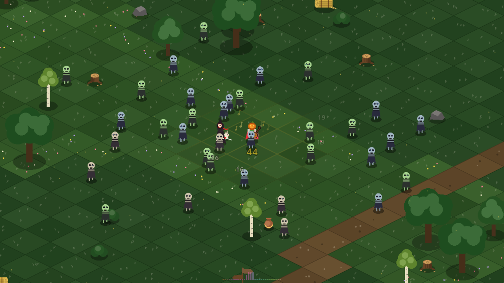
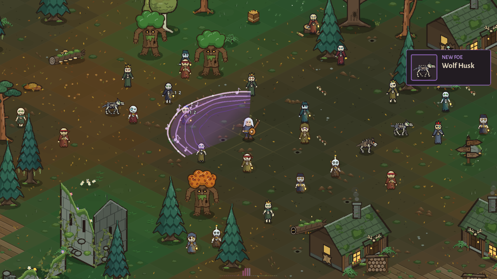
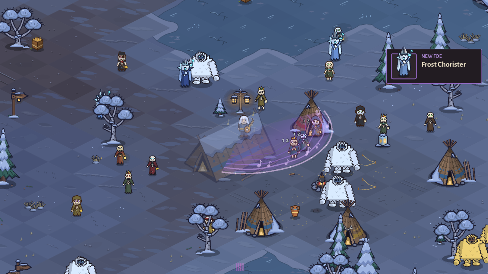
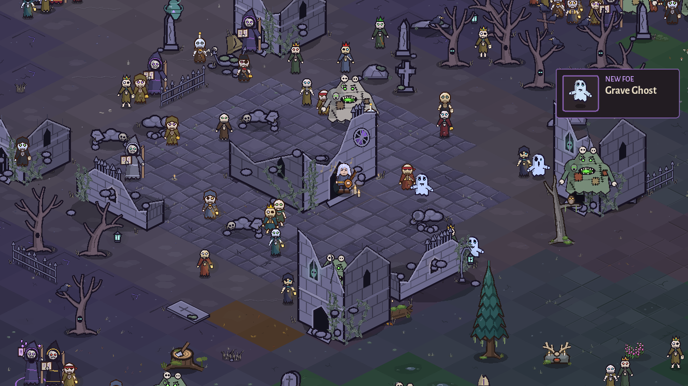
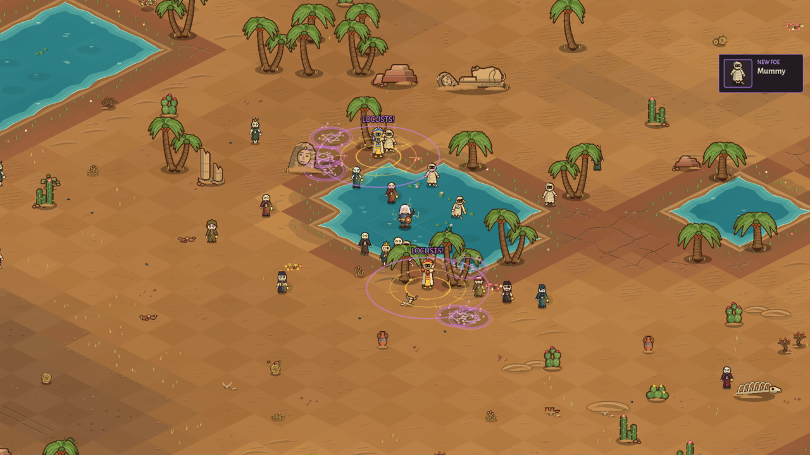

- **Every foe is redrawn.** All 22 foes from the Wailer to the Undead Pharaoh have a new design, and most come in several looks (well over a hundred between them), picked for each one as it appears, some only in their own biome. They also show what they are about to do: a wolf howls, a Bone Cantor chants, a Pharaoh raises its arms to cast, the bosses wind up their big moves. The plain Husk alone has more than 30 looks, from ragged sleeves to little party crowns, and is a little bigger.

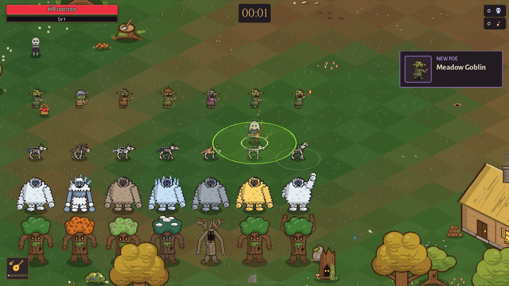
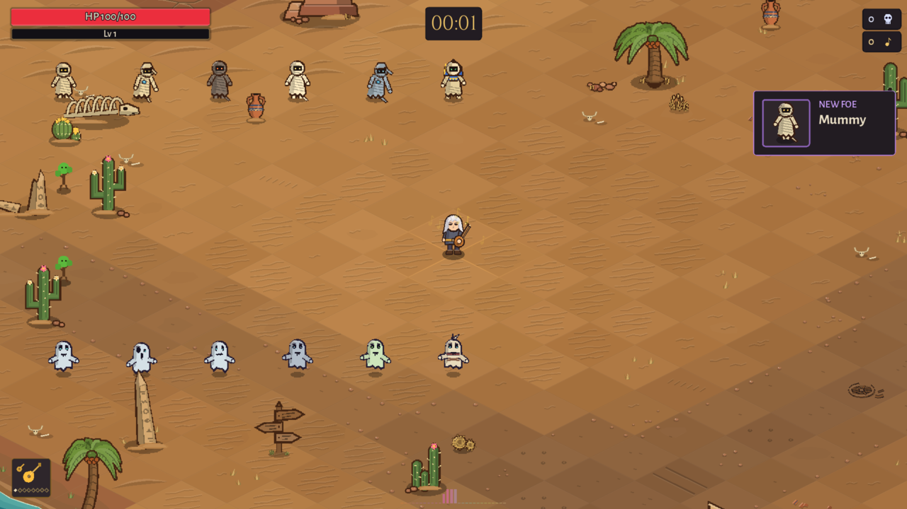

- **A new bard.** One figure is used everywhere, in a run, in the Mirror and in every menu, and he is drawn a little bigger in a run. He has a new face, a new set of hair styles, walks with his arms swinging naturally from the side, and holds his starting weapon in his hand.
- **Every piece of gear shows on the bard.** Every hat, hood, helm, chest piece, pair of legs and cape has its own cut and colours on him, in the game and in the menus, and every older piece has its own icon. Hoods are snug cloth that show your hair.
- **The Mirror:** eleven new hair styles (Wanderer, Ranger's Tie, Wolf Crop, Penitent, Topknot, Pilgrim's Knot, Court Fall, Long Braid, Ponytail, Bob and Flowing Waves) and a new Facial hair row. Every style that used to wait for a level is free from the start.

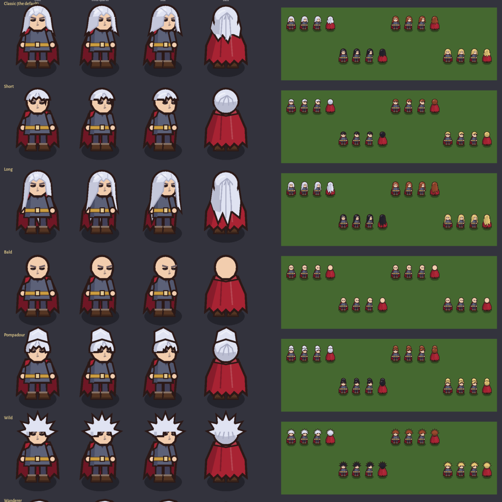

- **Gear sets.** 61 new pieces in 19 sets, each named for a kind of bard: The Troubadour, The Skald, The Old Wolf, The Court Bard, The Masque, Hooded Minstrel, The Grey Ranger, Knight of the Last Chord and more. A piece's card says which set it belongs to and how many of it you have found ("The Troubadour set · 2 of 4 found"). Sets are for looks: there is no set bonus.
- **Transmog.** Any head, chest, legs or cape piece you have found can be unlocked once as a look, for 500 Echoes (common) up to 4,000 (mythic), and worn over the piece in that slot. You keep the stats of what you have on and wear the look you like. Choose looks from the loadout's Looks button or right in the Collection. A head look and a vanity hat take turns.

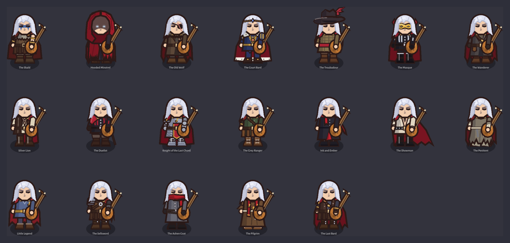

- **Every cape is its own health or level gauge.** Capes keep their own look in a run and each shows your health (or level) its own way: patches that colour one by one, a fringe, feathers, stars, flames, mist, ribbons of light. What is not lit has drained to ash.

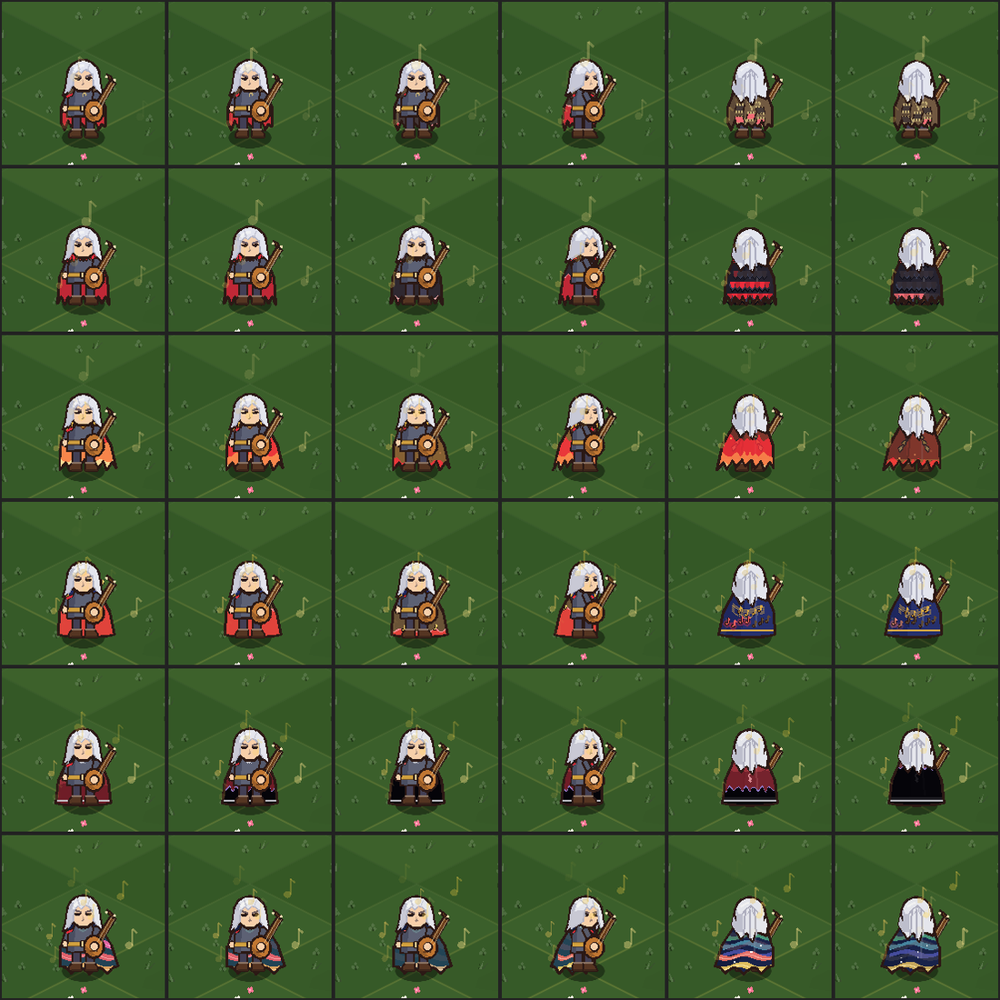

- **The Collection's gear page** has a Details / On the Bard switch, so you can see a piece on the bard before you wear it, and lets you unlock, wear or remove a look right there. Each slot is listed by rarity, common to mythic, with a set's pieces together, and a worn piece keeps its rarity border.
- **A new interface, the travelling songbook.** Every menu has been redone: lacquer, parchment and brass colours, new title and text fonts, bookmark tabs, ornaments and a page behind the menus. Text is larger everywhere, buttons say plainly what they do, gold always marks where you are and parchment marks what is chosen or worn, and every screen has one main button. Menus fit the screen they are on, larger on a phone or a Deck and never cut off.
  - **The Fountain of Echoes** rows show their levels as pips, with the full effect on the row, one buy button and a refund mode. Big numbers have thousands separators.
  - **Phones and the Steam Deck** have layouts of their own for the pause menu, the Sanctuary, the loadout, the Mirror, the title screen and the card choices.

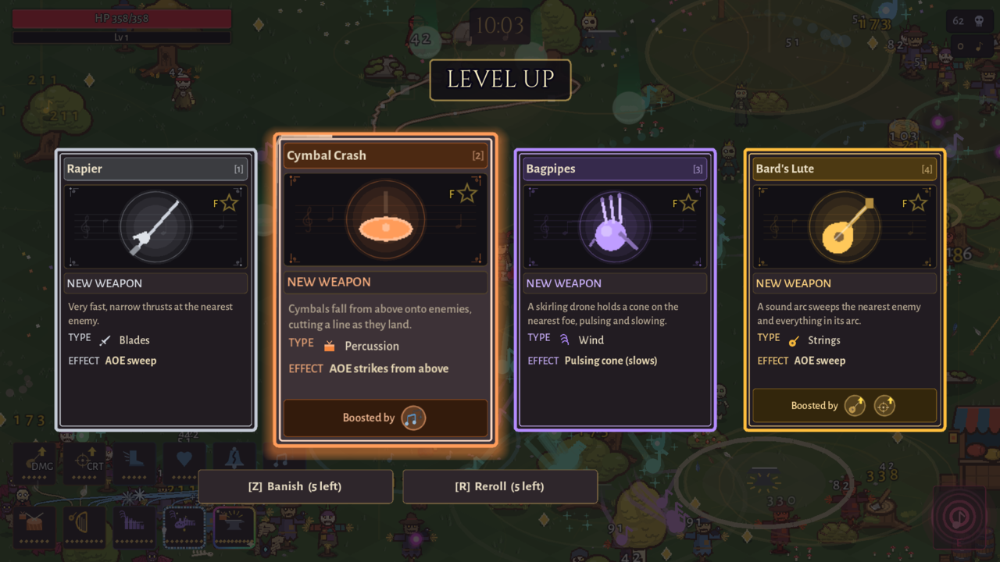

- **A favourite star.** Star any card, Collection tile or pause-menu chip (F on a keyboard, Y on a pad). A favourite card gets a gold rim, a glow and a FAVORITE tag, so you spot it at once. You can star things you have not found yet.
- **The camp grows into a castle court.** With the Fountain at its top tier the camp is laid out in avenues of marble and lawn with flower beds, lamps and pillars round the Fountain. The Armory and the Collection stand on raised stone showcases, you always arrive on a teleport pad, lamps light up one after another, butterflies come out by day and fireflies at night, banners flutter, and your companions practise now and then (Kage at the dummy, Rowan at the target, Morwen at her rune circle, Maestra with her book and her instrument).
- **Arrivals are little scenes.** When someone new comes to the camp, black bars slide in, the camera drifts over to them, they step out of a beam of light and their name shows. Press any key or tap to skip.
- **Landmarks in the new look:** the Resonant Stone, the ruined College, braziers, pillars and lanterns, and the wild Echo Willow beside a proper pond. The castle ruins, the harp's altar and the wild hedgehog in the meadow have their new look too.
- **The Sand Burrower** is a ridge of moving sand now, and its attack is one leap: it bursts out nose-up, arcs over with its jaws open and dives nose-first into the sand again, like a shark out of the water. The timing of the bite is unchanged.
- **The Silencer** that comes at the end of a long run has a new look.
- **Music bars:** a soft strip at the bottom of the screen shows the song's spectrum, with the kicks, snares and hats jumping up as they land. Switch it off in Settings > Graphics.
- **More starting weapons:** once found, the Rapier, the Hand Crossbow and the Ember Bolt can be a starting weapon too.
- **Poison.** The Graveyard Abomination's ichor poisons the bard for a few seconds: a little health twice a second, never below 1. The health bar turns green and breathes slowly until it wears off.
- **Wide screens see more.** On wide and ultrawide screens the world now fills the whole width, with foes appearing just past the real edge.

## Changes
- **Healing over time only comes from the Fountain's Mending** (at most 1 health a second). Gear, charms, relics and pets no longer heal you.
  - **Raven Cloak:** a hit now releases a burst of black feathers that cuts nearby foes, instead of a moment of safety.
  - **Mantle of the Silence:** a hit now silences the hostile notes around you, instead of nearly two seconds of safety.
  - **Aurora of the Final Song:** a hit now throws nearby foes back and slows them, instead of two seconds of safety.
  - **Drummer's Knucklebone:** every 8th kill takes 2 seconds off the Crescendo's wait, instead of healing.
- **The Crescendo** never recharges in less than 8 seconds, however many reductions you stack, and kills can shave at most about a third off one wait.
- **The late horde is bigger.** On desktop and the Deck many more foes can be on screen at once, and the stream keeps growing deep into a long run.
- **The biomes are bigger and blend.** Each region is half as wide again, so the Resonant Stone and the ruined College lie further out. Neighbouring biomes now meet over a wide band where their ground and scenery mix, the snow and the desert never touch, and villages, camps and ruins are spread out so none stand side by side or right beside a landmark.
- **Scenery behaves:** tall trees and walls in front of the bard turn see-through, so you never lose him; trees never stand on a building, a ruin wall or in water; hay bales and bushes keep off paths and plazas; a small tree is never hidden right behind a big one.
- **Endless or Loot is asked every run**, once your build is complete, and a ready fusion or evolution is always offered at a level-up before any endless card. In Loot Mode a chest shows a golden Echo note for each pick, and a chest with only Echoes in it skips its opening scene.
- **Every card is the same size**, a playing card, however much it has to say: busy cards squeeze their text and icons to fit instead of growing. Cards hold five icons in a row and "Evolves with" is drawn in rainbow colours.
- **Your weapons' shots appear just clear of the bard** instead of on top of him (they still hit foes that are right on top of you).
- **Foes show their own colours.** The coloured tints that whole waves wore are now only used in Listen mode, where they follow the music.
- **Keepsake chests** wear a tall violet beam with a ring, and an arrow at the edge of the screen points to one you cannot see. The Magnet Crescendo pulls chests in too.
- **Blade weapons** sound like a soft ring of steel instead of a crackle, and never machine-gun it however many you carry.
- **The Bagpipes'** cone turns smoothly and looks like music: faint staff lines with notes drifting out, no flashing fill.
- **Boost strings in the HUD** show for a few seconds after your build changes, then fade, and the pause menu shows only the strings of the slot you are on. The Companion and Crescendo slots in the pause menu have colour-coded strings to their upgrades.
- **The Fountain and boost icons** are objects of the world now (a gauntlet, a whetted blade, a plucking hand, a cracked bell, dice, a sandglass and more).
- **Listen mode** follows your music much more closely: separate kick, snare and hat detection, bass lines, leads and crashes each bring in their own foes in their own colours, and every note of the music can bring in a small formation of motes (one hit each, no XP; Settings can turn them off or thin them). Early foes have less health and the horde is full from the start.
- **Renamed:** the Phantom Maestro is the Phantom Meowstro, the first cape is the Tattered Cloak (and comes first among the capes), and six older pieces have new names: Broken-Quill Cap, Frayed Straw Hat, Frayed Linen Shirt, Rhythm Clogs, Bell-Strap Sandals and Homespun Mantle.
- **The Echo Tree** has a simpler look, and the planting scene closes on a tap.
- **The what's new panel** on the title screen scrolls when there is a lot to say.
- The Unlocks page hides its Fusions and Evolutions sections until you make your first one, and no longer lists the retired fusions.

## Performance
- **The late game is much faster.** The slowdown with a full build was never the horde: it was the drawing of weapon effects. With ten maxed weapons and fusions such as Wind Ensemble and Anvil Chorus, a GTX 1060 desktop went from about 52 to about 92 fps, and the work the graphics card is asked to do each frame was cut by more than half (943 draw calls down to 427). With ten maxed plain weapons it went from about 126 to 185 fps.
- **Bigger hordes run better:** 3,000 foes went from about 61 to 82 fps on the same machine, 5,000 from 44 to 54.
- **Fewer hitches.** The first level-up of a run no longer stalls (about 66 ms down to 20), and walking into new land is smooth because the ground is painted a little at a time.
- **The bard's hung weapons, notes, sparkles, saws, pattern weapons and note trails** are each drawn in a handful of steps instead of hundreds, and the pause menu and Sanctuary are only built the first time you open them.
- **Phones use less graphics memory**, and the camp is painted before it shows, so you no longer see black ground or props popping in when you come back.
- **No more shimmer:** scenery no longer wobbles by a pixel while the camera glides, and the death screen's zoom is steady.

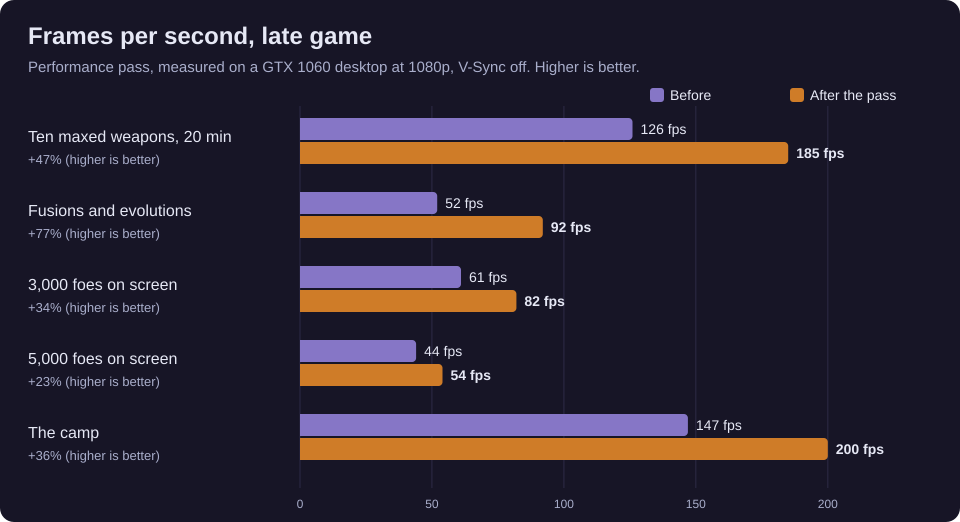
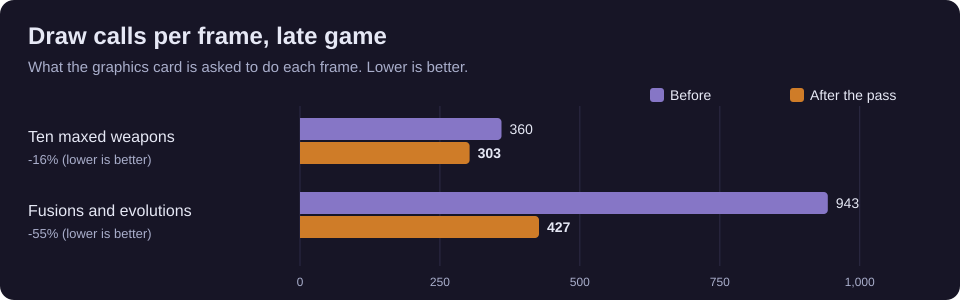

## Controller and menus
- **A controller legend** with real button pictures (Xbox, PlayStation, Switch or Deck) sits at the bottom of every menu, and every full-screen menu leaves room for it, so bottom buttons are no longer covered on the Deck.
- **Banish** is on Z or the left shoulder, with its button shown beside it. The card choices show Take, Reroll and Favorite in the legend.
- **Back** sits at the top left of the Sanctuary, and B or Esc always leaves. Esc or B in a camp conversation goes back one step.
- After you master a Fountain upgrade, buy a look, wear a piece, bring a pet along or wear a score, the focus stays on that tile instead of jumping to the top. Flipping tabs lands on the first item.
- In the Collection a click selects a piece and keeps the side on it; a second click wears it. Passing the mouse over other tiles no longer changes what is shown.
- The Endless or Loot question now comes up on its own, with nothing behind it that can be picked, rerolled or banished.
- On phones the card choices are as large as the screen allows, the build tiles step out from under the cards, gear finds sit beside the cards and the camp buttons are larger.

## Fixes
- The bard could turn invisible with a look whose colour moves.
- Seeing a NEW tile in the Unlocks page could freeze the Deck for a moment.
- Some Android phones closed before the first screen.
- The pause menu's This Run page was cut off at the right.
- The callout box was far wider than its text and could sit over the timer. It now fits its words and stays under the timer.
- The Healer's Smock's sash ignored the belt colour you chose.
- All achievements now show on the death screen after a revive.
- An exclamation mark hung in the air before a new arrival had teleported in, and pop-ups could appear over the arrival scenes.
- Kage was credited with damage done by the ward that keeps foes back while you talk to someone.
- Camp lanterns glowed where no lantern stood.
- The poison health bar flashed far too fast.
- The meadow's signposts had gone missing.
