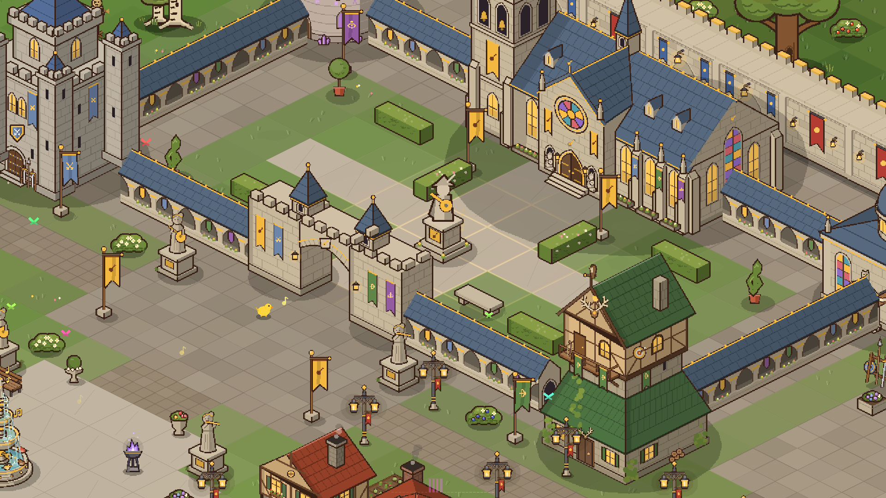
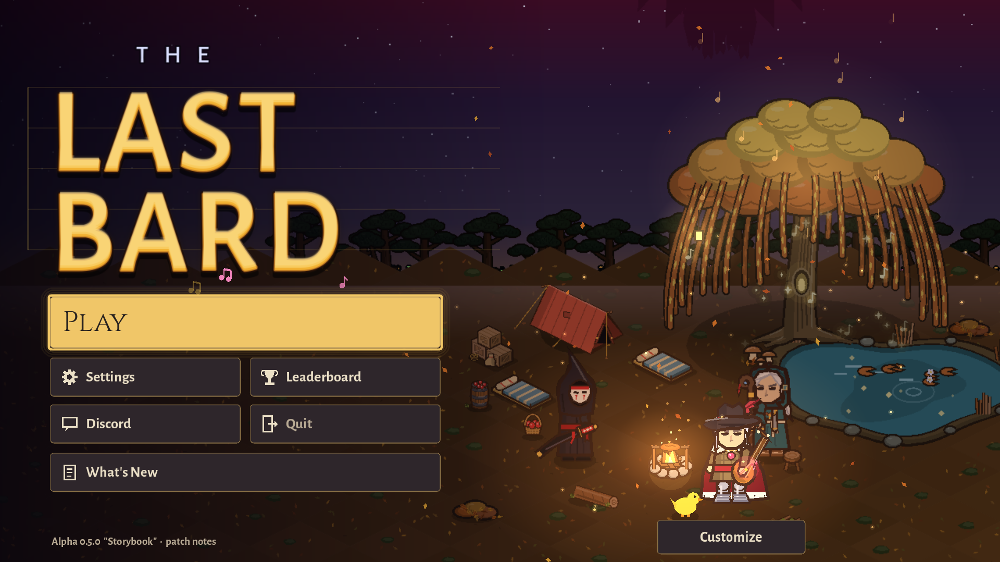
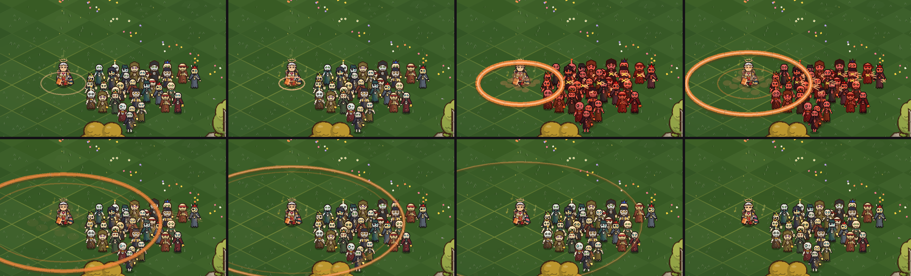
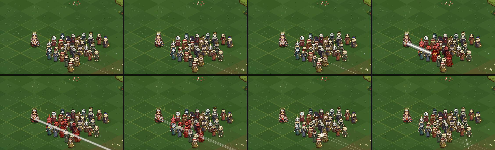
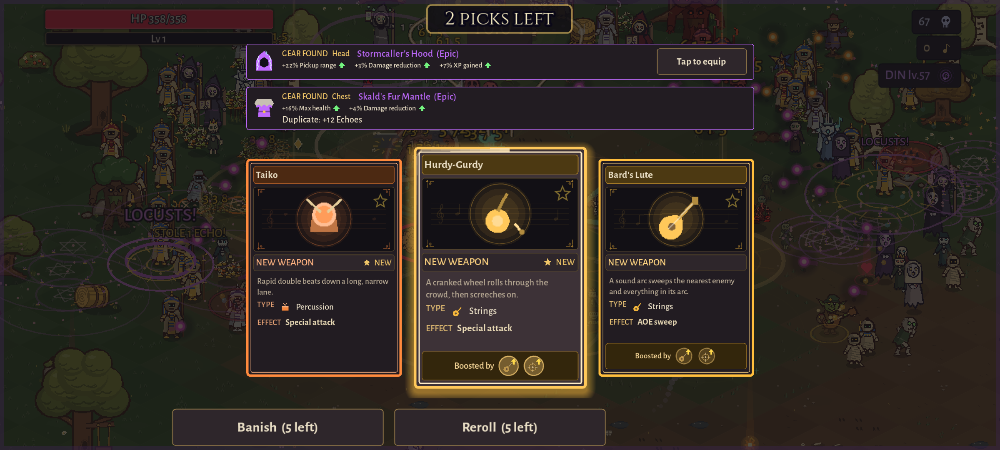

# The Last Bard: Alpha 0.5.1
*A rebuilt Sanctuary that grows from a ruin into a college town, a new title screen by the campfire, every weapon hitting harder, eight new boosts, and a phone interface that fits.*

## New
- **The Sanctuary is rebuilt.** The camp is now a college campus inside a castle fortress, with a port and a sea gate below its walls, about three times the size it was. It starts as a ruin and grows, stage by stage, into a grand town as you restore it: walls and towers, the College halls and cloisters, homes, the market, the quay and its ship.

- **Your companions moved in.** Kage, Rowan, Morwen and Maestra are redrawn in the bard's style and live in their own homes. When they practise you see it where they stand: Kage cuts at his dummy, Rowan shoots along her cabin, Morwen strikes her own dummy with light, each hit popping a damage number. Maestra sings one of four songs, and a new arrival gets a short scene that names where they live.
- **The Menagerie:** walk up to the little house inside the pets' fence to open the Pets page.
- **A new title screen.** A night camp around the Echo Willow and its pond: your own bard (with your gear and your pet) by the fire, and the companions you have found camped around it. It follows the season: green in summer, gold leaves in autumn, snow in winter, and violet and pumpkins at Halloween.

- **New title music, The Vigil:** a slow, dark piece with a choir, strings, drums and brass that ends on the bard's lute. The old lute theme is still in Settings > Audio.
- **A studio intro** plays before the title on launch (any key skips it).
- **The Echo Tree follows the season** in the Sanctuary too, with new autumn and Halloween colours. Settings > Gameplay can switch that off to pick its colours yourself.
- **Every weapon hits harder.** All 35 base weapons have new attack animations: a short wind-up, a heavier strike, sparks where they hit, foes that jolt when struck, and a follow-through that slows and fades instead of vanishing. Every base weapon's attacks are now in its music family's colour.

- **The Bagpipes, redone:** the bag fills, then three heavy waves burst out, the first shoving hardest, each slowing as it spends itself. A fourth wave comes at level 4 and a fifth at level 7.
- **Eight new boosts** that change how a run plays:
  - **Ensemble:** every weapon hits harder for each music family you carry.
  - **Fortissimo:** more damage to gold foes, elites and bosses.
  - **Close Harmony:** more damage to foes close to you.
  - **Sostenuto:** your hits slow foes for a moment.
  - **Rubato:** kills speed your weapons up for a short while.
  - **Lifesong:** every 40 kills heal you a little.
  - **Steady Nerves:** armour.
  - **Golden Ear:** more XP.
- **Three new Lute evolutions,** so the Lute now evolves with every other family:
  - **Bull Lyre of Ur:** a golden bull charges through the crowd.
  - **Saraswati's Vina:** scissoring beams, then lotus blasts that slow.
  - **Theorbo:** a giant neck that sweeps round you, then bass strings.
- **Every base weapon you have found can be your starting weapon,** not just the first ten.
- **Death animations:** Grave Ghosts rise and fade to a wisp, bats tumble down, and Locust Swarms scatter.
- **Keepsakes** now show in the death screen's "New in your collection" and the pause menu's "Unlocked this run".

## Changed
- **New weapon icons and held weapons (hotfix):** every base weapon has a new inked icon in its music family's colour, and the weapons the bard holds and circles him are redrawn in wood, brass and steel. Voice weapons are sung instead of held: each one sends up its own style of notes, so you can see every voice weapon you carry.
- **Phones get their own layouts:**
  - **The card scene** is laid out like the PC's: the title on top, gear found as a slim strip, the cards centred.
  - **The pause menu** fits with nothing cut off, and Stats is in two columns.
  - **The Upgrades page** has wider grids.
  - **Pop-ups and spoken lines** keep clear of the Crescendo button and your build.
  - **The bard** fits his box in the Collection.

- **iPhone:** now treated as a phone everywhere (quality, crowd size and the leaderboard tag).
- **Poison** lasts longer but does less in all, and while it lasts only hearts and health cards heal you.
- **Pop-ups:** a new pet's pop-up says NEW PET and its name, and the Monsters page is now called Foes.
- **Wild and Pompadour hair** are redrawn to match the other styles.
- **The Sanctuary:**
  - The Mirror stands on the grass behind your house.
  - The Resonant Stone's arch faces north-east, clear of the houses.
  - Gates sit in their walls, low walls run as one, the College of Blades meets its walls cleanly, rubble sits in the ground, and paving blends into the grass.

## Fixed
- **Cards and a walking thumb:** on a phone, the cards no longer take the highlight from the middle one when a thumb is still walking the bard as they come up.
- **Loadout:** the gold ring and the worn piece's frame are no longer cut off at the top and left.
- **Max health:** the pause menu and the health bar now always show the same number, and the other stats round the same way.
- **NEW marks:** a NEW mark in the Foes list stays until you move on to another foe.
- **Keepsake tiles** no longer get a tick when you look at one.
- **Achievement toasts** no longer appear over the death screen (they are listed on it).
