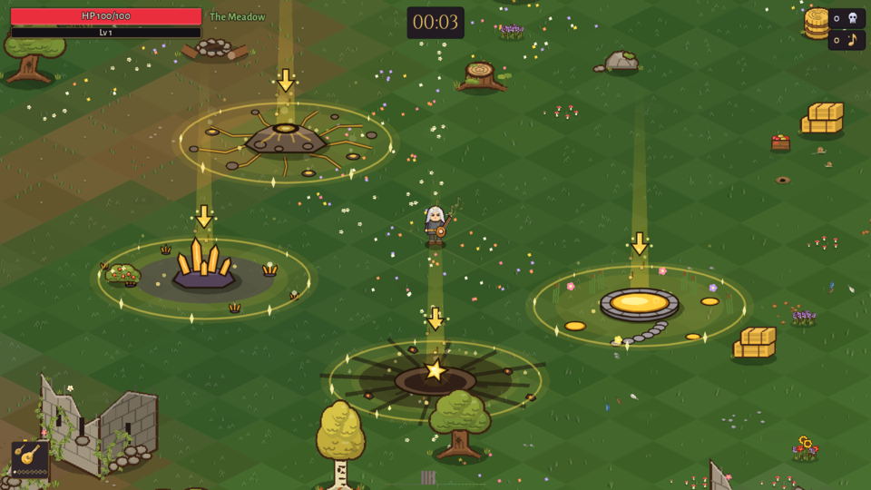
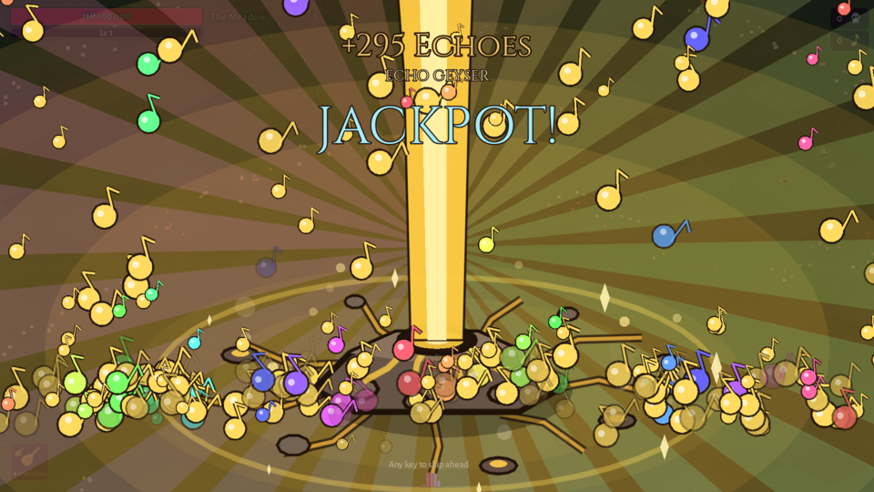
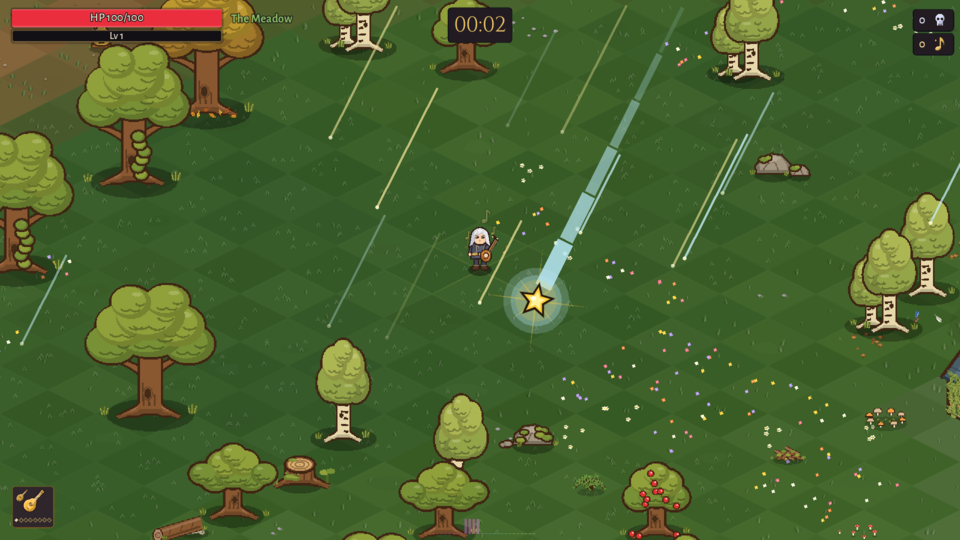
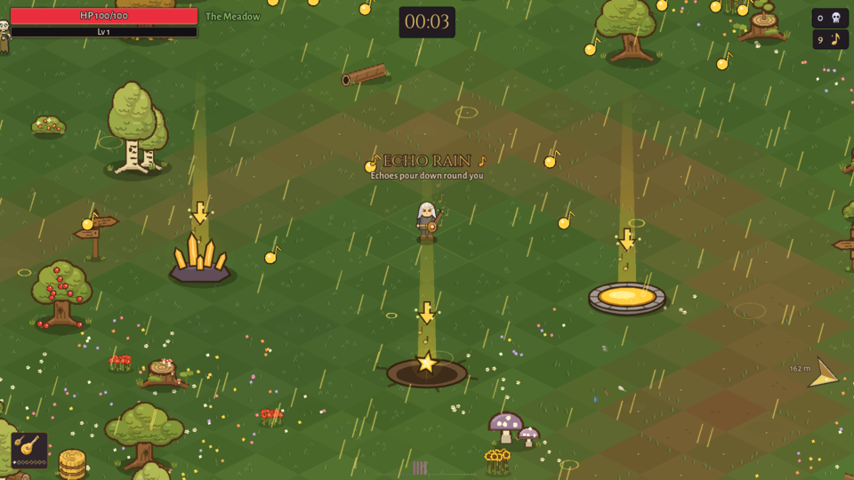
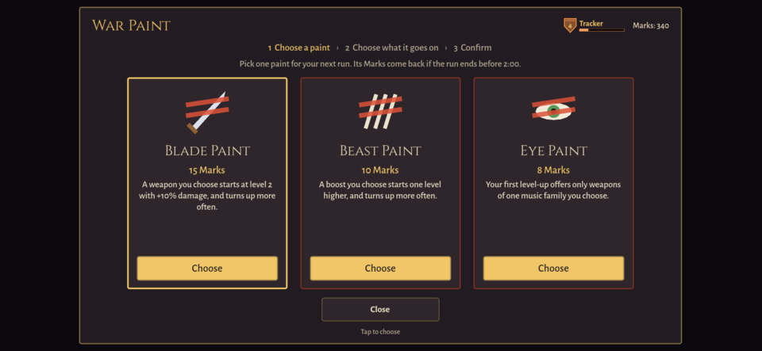
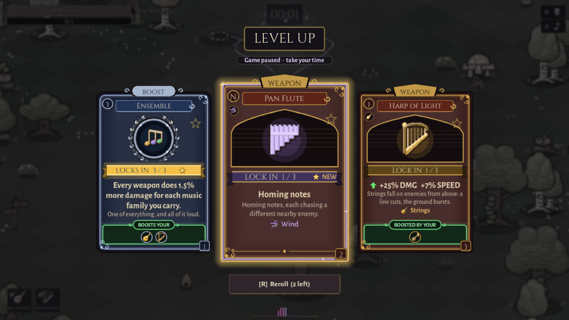

# The Last Bard: Alpha 0.5.10.0 "Struck Gold"
*Geysers, pools, singing crystals and falling stars full of Echoes, and a clearer War Paint.*

## New
- **Echo Events.** The golden Echo Chest is gone. Any foe may now, very rarely, set off one of four Echo Events:
  - **Echo Geyser:** a glowing vent that erupts a column of gold.
  - **Echo Wellspring:** a pool of liquid gold that jets up and overflows.
  - **Singing Geode:** amber crystals that crack wider with every tier.
  - **Fallen Star:** first a shower of shooting stars across the sky, then the star itself streaks down into a crater.

  Each one stands in its own little scene, announces itself with a pop-up, and has an arrow over it and at the edge of the screen when it is out of sight. Step on it to set it off.

- **Bigger jackpots.** An Echo Event climbs tier by tier, and every tier is far bigger than the last: more gold, a bigger eruption, the screen leaning in and shaking, Echoes raining from the sky near the top. Echoes clink like coins as they land, and each tier sounds bigger. Payouts now run from 15 to 400 Echoes.
- **Skipping no longer skips the fun.** Pressing skip jumps straight to the final tier and still plays it.

- **The Echo Comet.** Very rarely, an Echo Event is a comet: a heavier shower of gold and ice-blue stars, a frozen crater, and it always climbs to tier 3 or higher.

- **Echo Rain, a new power-up.** A golden storm fills the screen for a few seconds and rains down 20 to 100 Echoes.

- **Track your Echo Events.** The Journey page counts the Echo Events you have found, how many of the four kinds, your jackpots and your biggest payout. Five new achievements and three new titles to earn.
- **Don't miss one.** An Echo Event about to fade warns you 15 seconds before it goes.

## Changes
- **War Paint is now three simple steps:** choose a paint, choose what it goes on, then confirm. Each step has big, clear choices, and the last one spells out exactly what your paint will do.

- **The card that locks in stands out.** When an endless card's next pick locks it in (3/3), its ribbon turns solid gold.

- **Echo Hunter** (Fountain of Echoes) now makes Echo Events more common.
- **Game stats on the Leaderboard tell the whole story:**
  - Weapons carried now count every weapon a run used, including ones that went into a fusion or evolution, and show how often each was fused away.
  - New sections: starting weapons, each bard's averages, the average run, Crescendo scores and how grown the Fountain was.

## Fixes
- **The Mirror on iPhone no longer jumps up the page** when you tap a vanity piece near the bottom.
- **World card emblems hide behind menus.** They no longer cover the death screen's Echo count, the level-up cards or the pause menu.
- **Keepsake chests are safe.** A chest dropping while four were already out could remove a keepsake chest you hadn't reached yet. It now only ever removes a plain chest.
