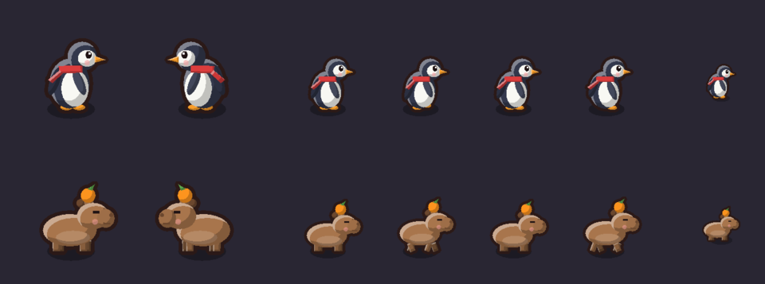
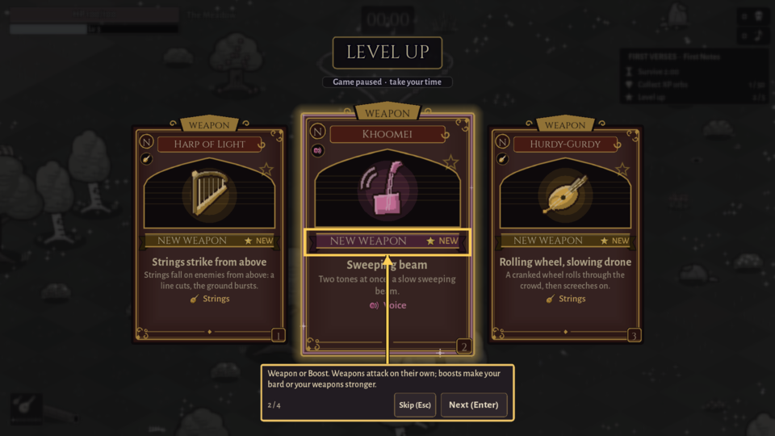
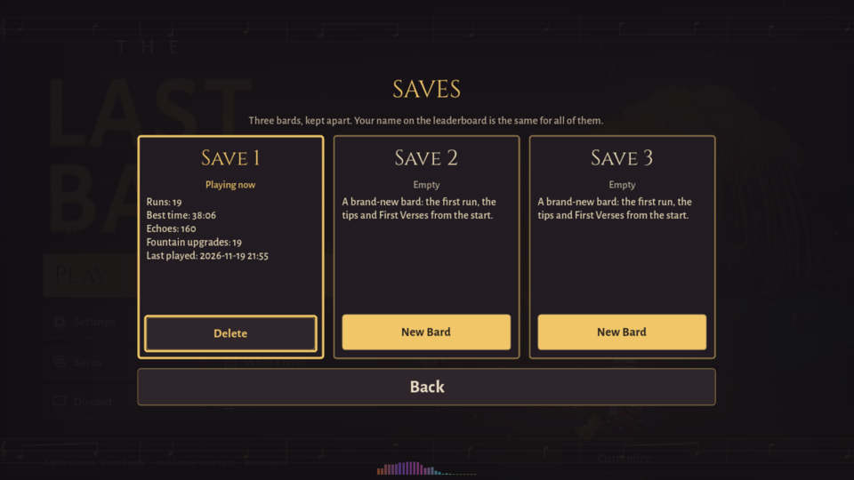
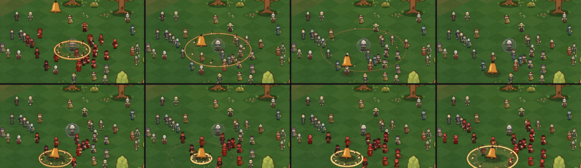
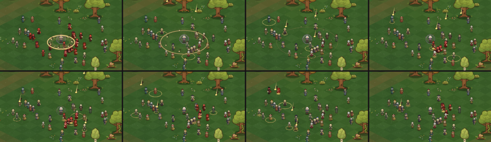

# The Last Bard: Alpha 0.5.11.0 "First Verses"
*A guide for your first runs, gentler early minutes, two new pets, three save slots, and a Crescendo for every style.*

## New
- **First Verses.** Small goals ("verses") that teach the game from your very first run: survive, collect XP, smash crates, open chests, max out a weapon, fuse and evolve, find the Resonant Stone and more. Five chapters, sung in any order, in any run.
  - Every verse pays Echoes the moment it is done, with a callout and a line on the death screen. Nothing to hand in.
  - Chapters give bigger rewards: Echoes, gear, and **a full set of common gear** in your first chapters.
  - The live verses sit in the top right corner (tap to fold them on a phone), and the pause menu has a new **Verses** tab with every chapter. You can hide the list in Settings.

- **Two new pets: Waddle the Penguin and Yuzu the Capybara,** for finishing chapters of First Verses.

- **A welcome for new bards.** Your first run opens with one short pause: survive as long as you can, it gets harder the longer you last, and every run you come back stronger. Then small tips appear as things first happen (the horde, XP orbs, the timer, your band, Echoes, chests, gold foes), each with Next and Skip Tips. The words follow what you play with: keyboard, controller or touch.

- **Your first level-up explained.** Arrows walk you through a card: what it is, what it does and its music family, what it works with, rerolls, and how to pick.

- **The Crescendo, shown.** Finding the Resonant Stone pauses on a short animated lesson with your own key or button.

- **Maestra's lessons.** Once you have made your first evolution, Maestra Orsolya teaches you one you have not found every few runs, so you can fill your Collection without making every evolution yourself. If your runs keep ending early, she teaches you an easy weapon to start with instead. She lets you know when you arrive in camp.

- **Save slots.** A new **Saves** button on the title screen: three bards kept apart. Start a new bard, switch between them, or delete one (it asks first). Your name on the leaderboard is the same for all three.

## Crescendos
- **No more tiers.** Every Crescendo is now one Crescendo, as it is. Its colour (white, green, blue, violet, gold) only says how rare a find it is, not how strong.
- **Ten new Crescendos,** each its own way to play: **Echo Step** (blink into the crowd and burst twice), **Drumline** (marching shockwaves), **Mirror Ensemble** (four glass bards play beside you), **Black Note** (pulls the crowd in, then implodes), **Lullaby** (puts foes to sleep: sleeping foes take double damage), **Bell Tower** (a great bell drops on the strongest foe), **Spinning Record** (a disc spirals out), **Siren Song** (charmed foes fight each other), **Starfall** (notes rain across the screen) and **Pied Piper** (the horde follows a lure, then it explodes).
- Your old Crescendos carry over: owning any version of one means owning it, and the extra versions are paid back in Echoes.

## Changes
- **Gentler first minutes for new bards.** In your first few runs the horde eases in for longer, the tougher foes arrive a little later, and gift chests arrive at 3:00, 5:00 and 8:00.
- **No more silent surges.** Before you have a companion, the boss moments used to be just a louder horde. Now they are announced ("The Silence gathers..."), and holding them off drops a chest.

## Hotfix
- **The Encore is gentler.** It used to get so hard so fast that three minutes of it were harder than the whole fight before it. Foes now grow tougher more slowly (about a third of the health at three minutes), and the crowd builds over six minutes instead of two. It still never ends.
- **Save slots show their bard.** Each save in the Saves menu shows that bard's face, so you can tell them apart at a glance.
- **"Last played" on a save shows your own time,** not UTC.
