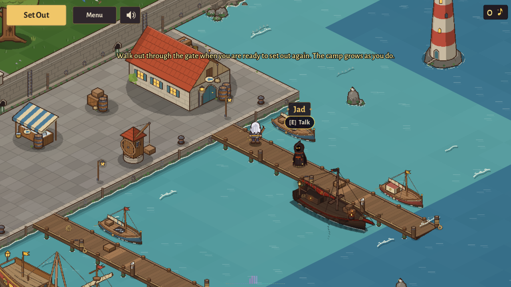
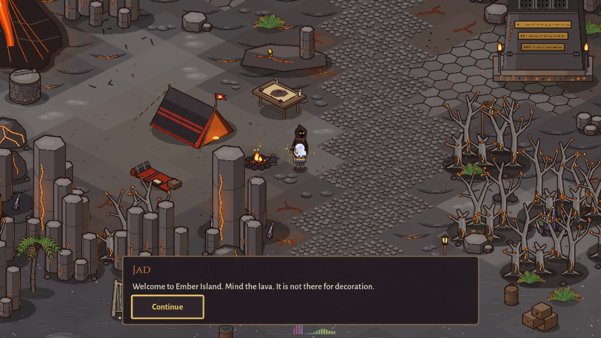
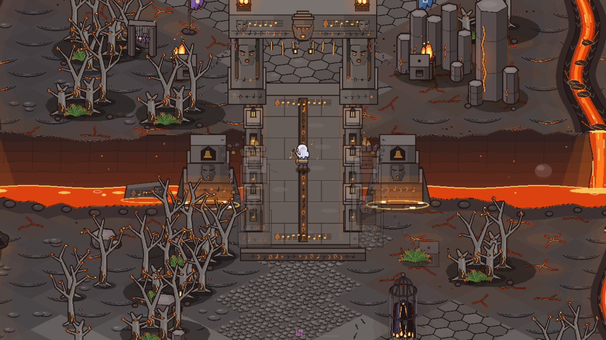

# The Last Bard: Alpha 0.5.12.0 "Ember Island"
*Jad sails in on his black boat and takes you to Ember Island, with eight new songs from the mountain.*

## New
- **Jad arrives.** Once you have beaten the Drum Lord, the Choir and the Phantom Orchestra (each at least once), a hooded sailor named Jad moors his black boat at the Sanctuary's north pier. Talk to him to hear about the island and the trial inside its volcano.

- **Ember Island.** Sail with Jad to a volcanic island and explore it on foot: step off his boat onto the jetty, cross the black beach, visit his camp by the fire, the forge, the shrine of the fallen and the Board of Records, and cross a great old bridge over a chasm of lava to the gate in the mountain. His boat takes you home whenever you like.

- **Eight new songs.** Ember Island has its own music: intense 8-bit and synthwave tracks that play while you explore and shuffle when one ends.
- **Power-ups in the Journal.** Every power-up, its picture, where it drops and what it does.

## Changes
- Ember Island has its own pause menu and the Menu and mute buttons, as in the Sanctuary.
