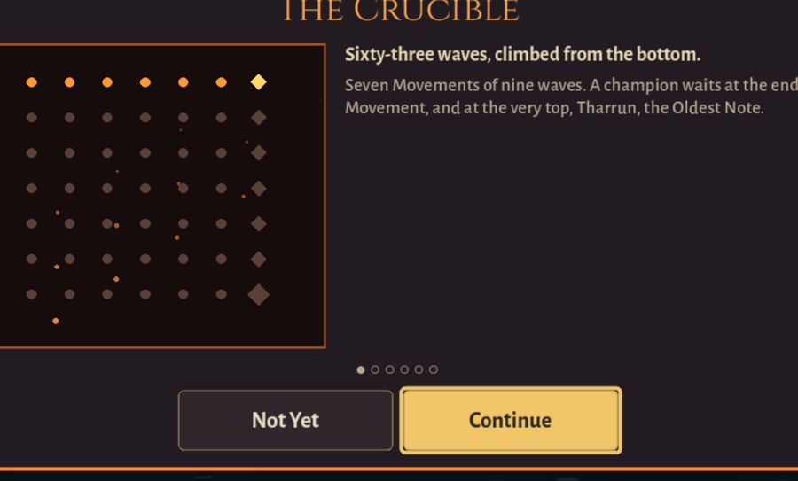
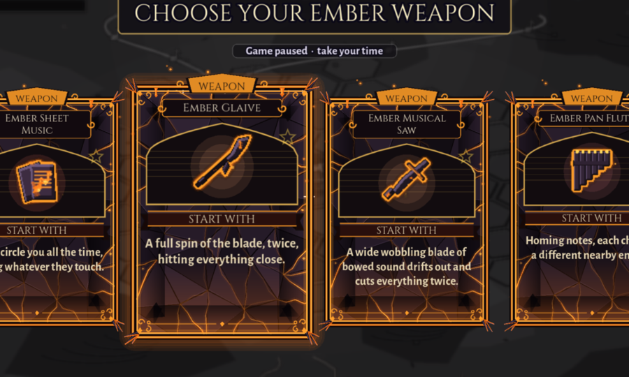
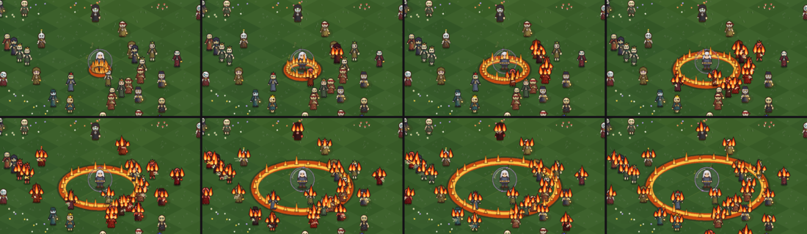
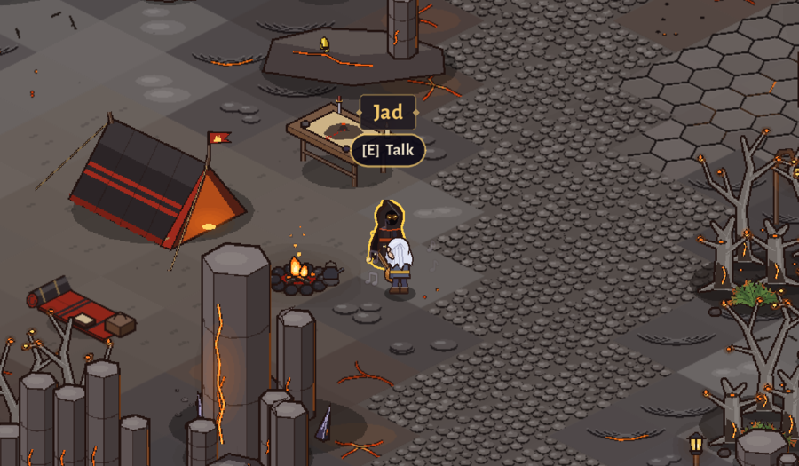
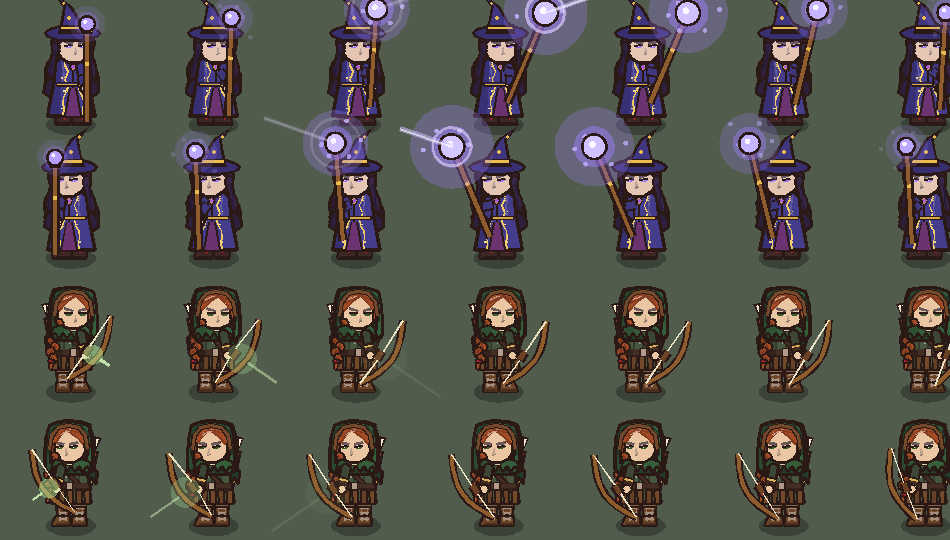
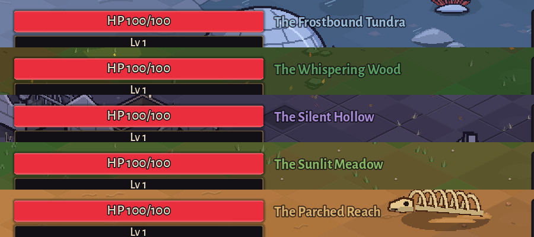

# The Last Bard: Alpha 0.5.12.1 "The Crucible Opens"
*The gate in the mountain is open: climb the Crucible, sixty-three waves to the Oldest Note.*

## New
- **The Crucible is open.** Walk up to the gate on Ember Island and enter the trial inside the volcano: 63 waves in seven Movements of nine, a champion at the end of each Movement, and at the very top, Tharrun, the Oldest Note. You go in with nothing but your Fountain upgrades, choose an Ember weapon, and build your climb wave by wave. One life, no revives.
- **The rules, before you go in.** The gate opens a few short pages, each with a little animation: how the climb works, what comes in with you (only the Fountain), Ember weapons, the reward after every wave, the mountain's trials, and the prize at the top.

- **Ember weapons.** Every weapon inside the Crucible is its Ember version, and any hit can set a foe alight.

- **A reward after every wave:** choose new cards, a piece of gear for the climb, or supplies. Clear a wave without a hazard hitting you for double Echoes and a richer reward.
- **The mountain teaches.** Lava, eruptions on the beat, meteors, scorched ground and the champions' great blows hit hard and ignore armour: keep moving. Pillars stop shots, Ember Conduits shield the champions until you break them, and a big attack you dodge leaves a champion open. Each trial is shown the wave it begins.
- **The prize.** Reach the top and the Cape of Embers is yours, with the Ember skin and the **Crescendo of Embers**: a wall of fire that sets everything it touches alight, then pools of lava that erupt under the thickest crowds. The burn takes a share of each foe's full health, so it keeps up however tough they grow.

- **The Ember skin everywhere.** Once earned (and switched on in Settings), your cards, weapon and gear icons, your weapon and boost tiles, the weapons you carry and every attack take on obsidian and fire.
- **28 Crucible achievements,** from your first climb to a flawless last wave, with **10 flaming titles** for the leaderboards and the Mirror, and six pieces of ember vanity to wear.
- **Three Crucible pets:** a salamander, a magma snail and a cinder crab, found by climbing far enough.
- **Your first landing on Ember Island** is a short scene: the island's name rises, and the camera shows you Jad's camp, the Board of Records and the gate.
- **Back to the island.** A climb ends back on Ember Island, and Jad has a word about how far you got.

## Changes
- **Ember Island works like the Sanctuary.** The place in reach wears the same gold outline, name plaque and button, and you can tap or click anywhere on it to use it: Jad, his boat, the Board of Records, the forge, the shrine and the gate. Jad gets the outline on the Sanctuary's pier too.

- **Rowan and Morwen attack with more flair.** Morwen raises her staff, the orb gathers light and she casts a bolt from it; Rowan pushes her bow out to aim, and it kicks back as the string snaps.

- **Every biome has its full name,** in the corner of the screen, on Andy's hunts, in the Journal and on keepsakes: the Sunlit Meadow, the Whispering Wood, the Frostbound Tundra, the Silent Hollow and the Parched Reach. "Lands" are now "biomes" everywhere.

- **A badge for your card mode.** Once you choose what the cards give after every real one is taken, the corner shows it: LOOT MODE (a gold chest) or ENDLESS (a blue card).
- **The "Find a village" task is gone.** Its common gear piece now comes with "Visit 2 biomes in one run", so you still get the full common set.
- **Spek and Doug only go bonking** the residents while they are walking with you and no menu is open, and you only hear them when they are on screen.

## Fixes
- Ember Island: you can walk through its trees (basalt and rocks still block), the bridge's front towers now line up with the bridge, Jad's boat no longer turns see-through, you walk over Jad's bedroll instead of under it, and the unclear cape cage is gone.
- Ember Island no longer shows black past its edges on wide phones.
- The Board of Records starts with every mark dark and lights one for each wave you reach.
- The Echo Seed's "found in" line names the biome properly.
- The Crucible's card screens are much lighter to draw, so phones stay smooth.
