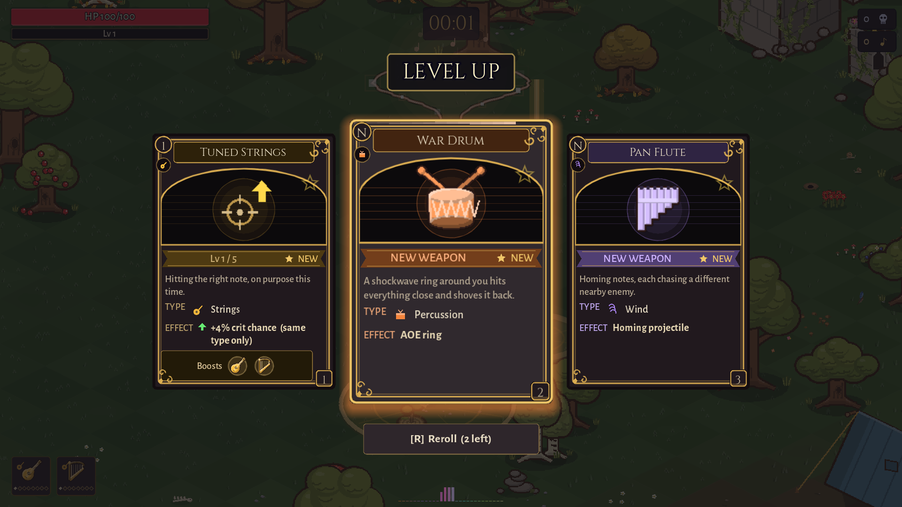
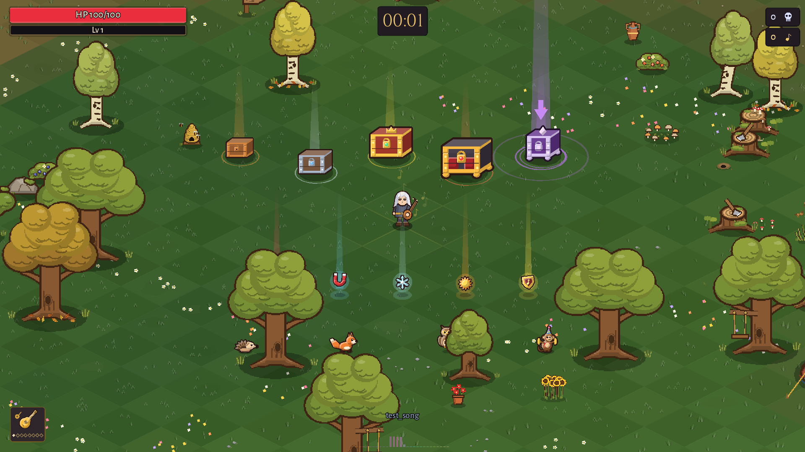
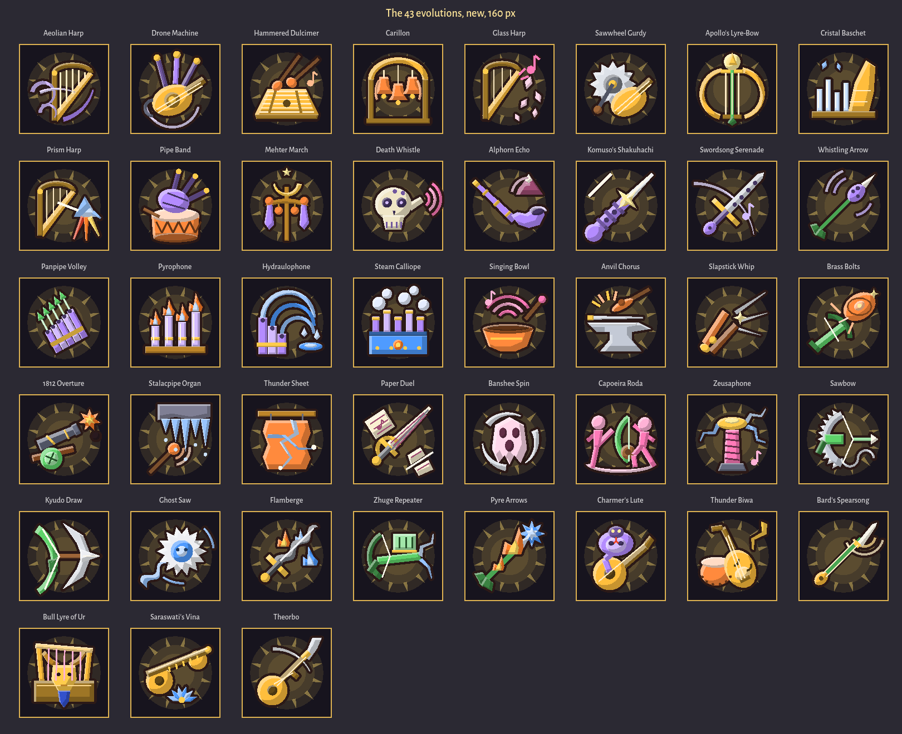
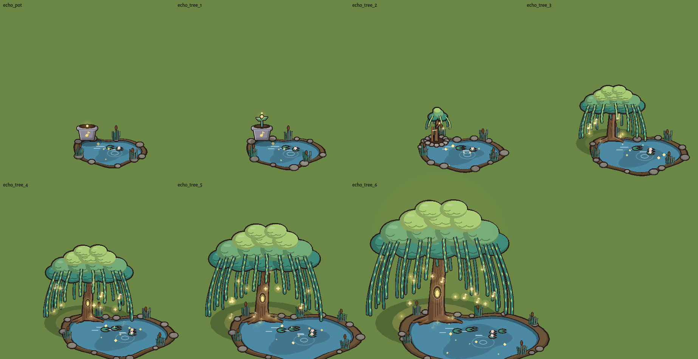

# The Last Bard: Alpha 0.5.2
*Gilded cards, new chests and treasure, every icon and every evolution redrawn, pets in the storybook style, an Echo Tree that grows into a willow, and a phone pause menu that keeps out of the way.*

## New
- **Gilded cards.** Level-up and chest cards are now gilded songbook pages: a title plate that fits long names on two lines, an arched picture window, the card's level or NEW in the top corner with its music family under it, and its key (1 to 4) in the bottom corner. The green and red arrows show what a card raises or lowers, and the Boosts / Boosted by / Fuses with / Evolves with row runs the full width of the card.

- **New chests.** Chests are banded strongboxes in bronze, iron and gold. Mini bosses drop their own chest in black iron and crimson, and a keepsake comes in a violet casket. A chest now opens on the ground first, then big in the chest scene.
- **Power-ups show what they are:** a heart, a magnet, a snowflake, a sun and a shield, each over its own glow.

- **Relics and charms** are redrawn in their own materials with a rim in their rarity's colour. Your relic now floats around the bard in a run, and your charm hangs on his chest as its own piece.
- **Pets** are redrawn in the storybook style, in runs, in the camp and in every menu.
- **Every icon is redrawn:** keepsakes, every boost, the Fountain's upgrades, the Crescendo scores, every head, chest, legs and cape piece (each set's boots now have their own shape), College crests, companion emblems, the empty gear slots, and the small music-family glyphs.
- **All 43 evolutions have new icons:** each one a single new instrument made from its two parts, in both families' colours with a gold glow.

- **XP gems and Echo notes** are redrawn: each tier of gem is bigger and more faceted, and big Echo drops are a beamed pair of notes with a gold star.
- **The Echo Tree** grows from a seedling into a full Echo Willow, its pond widening as it grows, in every season's colours. The Echo Seed and its planter are redrawn too.

- **The Armory's mannequin wears your real gear,** drawn exactly as on the bard. Settings > Gameplay can switch it between what you are wearing and the best piece you have found for each slot.
- **The camp's other old pieces are redrawn:** the Collection rack, the card book, the Leaderboard and the Halloween pumpkins and cauldron.
- **Roof windows are real dormers** with their own little roofs, on the meadow houses and in the Sanctuary.

## Changed
- **A College's own family now counts for your starting weapon too:** a blade under the College of Blades starts at level 2, like any other weapon of the College's family.
- **Stats show Rubato:** Attack speed in the pause menu includes Rubato's boost as it stands, e.g. "x1.12 (Rubato +6%)".
- **Phones: the pause menu's This Run page** has a reading column on the right, so a chip's details never cover the other chips or their strings. The bottom row of slots is smaller and fits under the gear, and the bard is drawn bigger.

## Fixed
- **Trees no longer stand against houses** with their crowns drawn over the roof.
- **Phones:** the pause button no longer sits on the Echo counter, and the highlighted card is no longer cut off at the bottom of the card scene.
