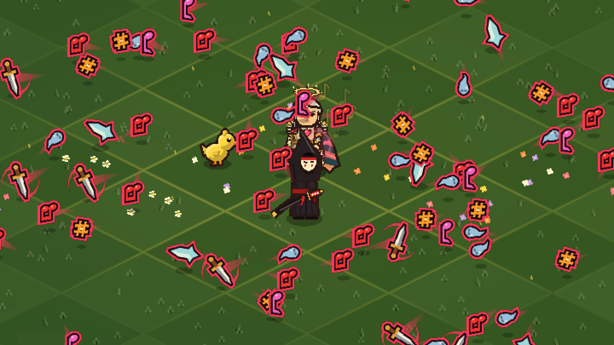
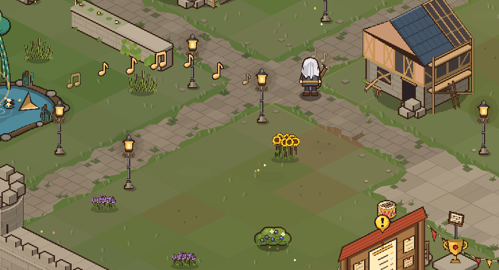

# The Last Bard: Alpha 0.5.3
*Enemy shots redrawn so you can always tell them apart, colour-blind modes and a brightness slider, a note trail in the camp that leads you to the Echo Tree first, and a clearer screen late in a run.*

## New
- **Enemy shots are redrawn.** Every shot a foe throws now has an ink outline and a rose-red rim with a short rose tail. Nothing the bard throws uses that colour, so even a crowded screen shows at a glance what is coming at you. Enemy notes hang stem down; your own notes stand stem up.
  - **Each foe has its own shot:** a sand spearhead for the Undead Pharaoh, a sharp sign for the Discord, beamed notes for the bosses, a wisp for the Phantom Orchestra, an ice shard for the Frost Chorister and a slime glob for the Graveyard Abomination.
  - **The goblin's dagger** spins end over end, and the Yeti throws real snowballs that tumble the same way.
  - **Notes your Crescendo throws back** are gold with a bright streak, so they never look like a threat.
  - The new shots are about the size of the old ones, and busy fights draw a little faster than before.

- **Colour-blind modes.** Settings > Graphics has a Colour-blind mode for protanopia, deuteranopia (both red-green) and tritanopia (blue-yellow), with a Strength slider. It covers the whole game, menus included. Places where colour was the only signal now have a second one: gear and Crescendo tiles show their rarity as one to six small diamonds, and the health bar says POISONED while you are.
- **Brightness.** A Brightness slider is the first row of Settings > Graphics, from 70% to 140%.
- **The camp's note trail** is redrawn in the inked look and flows in a gentle arc. When the Echo Tree has Echoes ripe, the trail leads you to it first, in the tree's own colour; once you have plucked them, it turns to the Fountain if you can afford an upgrade.

- **A headgear switch** sits by the bard's feet in the pause menu's This Run page and in the tent's loadout, so you can hide or show his hat without going to Settings.

## Changed
- **A clearer screen late in a run.** From about the eighth minute your own attacks fade a little close to the bard, and are at full strength again a short step away. Nothing is removed and they hit just as hard. Enemy shots, chests, orbs and pickups never fade.
- **Every weapon card says what the weapon really does.** Each of the 35 weapons has its own short effect line, such as "Rapid narrow thrusts" for the Rapier and "Strike, then sympathetic strings" for the Sitar. No card says "Special attack" any more.
- **The Echo Tree's camp callout** only says the tree is ready to harvest; you see how many Echoes when you pluck them.
- **The FPS readout** sits just to the right of the health bar in a run, clear of a phone's rounded corners.
- **Unlocks on touch:** tap the selected icon again, or any empty space on the page, to let go of it and clear its strings.
- **Butterflies and sparrows** fly smooth loops and fade in and out instead of popping from place to place.
- **Leaderboard Game stats** count each weapon's own damage, so a weapon that was fused away still gets its share.

## Fixed
- **Arrival scenes** show the camp's far walls (Rowan's arrival showed open grass where the west wall stands).
- **The Lute Goblin's caltrops** no longer land inside houses or behind roofs.
- **Level-up cards on phones** no longer settle and then grow a moment later; every card is its final size from the first frame. In a chest's card reel the highlighted card no longer loses its lift.
