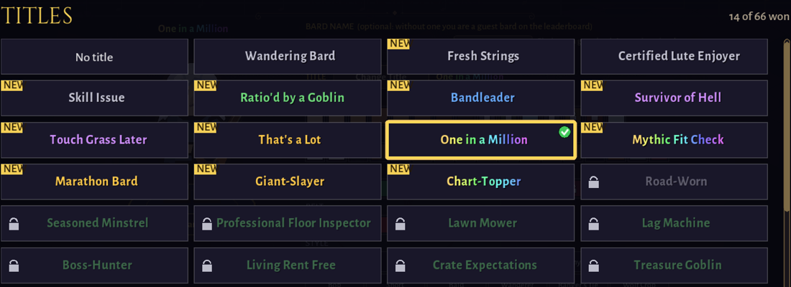
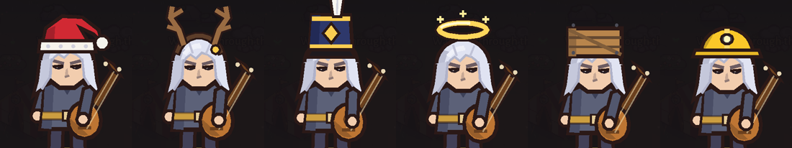
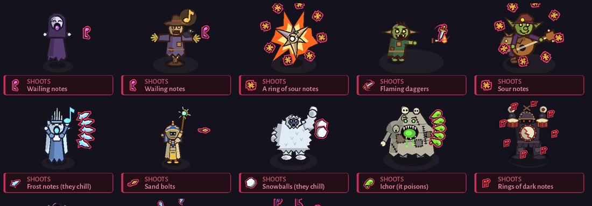

# The Last Bard: Alpha 0.5.4
*Titles to win and wear beside your name, a Mirror that lets you try on anything before you earn it, six new hats, and a Journal that shows what every foe throws.*

## New
- **Titles.** More than sixty titles to win and wear beside your bard's name. Choose one at the Mirror with the new **Choose Title** button.
  - **Won with achievements:** from meme ones like *Skill Issue*, *Ratio'd by a Goblin*, *Git Gud*, *Main Character* and *Certified Lute Enjoyer* to big chases like *That's a Lot* (50,000 kills in one run) and *One in a Million*.
  - **Won on the leaderboard:** reach the top 3 of any board (all versions) for its own title, such as *Marathon Bard*, *The Horde's Nightmare* or *Frequent Faller*. First place on any board gives *Chart-Topper*. Once won, a title stays yours.
  - **Colours by rarity:** common grey, uncommon green, rare blue, epic violet that pulses, legendary gold with a glint running along it, mythic a slow rainbow. With Reduce flashing on they hold still.
  - **Where they show:** beside your name on the leaderboard, and over your bard in the Mirror, the loadout and the title screen. Never in a run.

- **Try before you earn.** In the Mirror, pick anything still locked (a skin, hair or eye colour, a belt, a hair style, facial hair, a hat or a title) and your bard wears it for a look. Nothing is saved: pick something you own, or leave the Mirror, and you are back to your own look. The line under the choices says how to win it.
- **Six new hats.**
  - **The Winter Festival** (December 10 to January 6) gives the *Festive Stocking Cap* and the *Reindeer Antlers* just for playing. They are yours for good and come back every year.
  - **Won with achievements:** the *Bandleader's Shako* (The Whole Band), the *Halo of Applause* (Half an Hour of Hell), the *Crate Helm* (Crate Expectations) and the *Floor Inspector's Hard Hat* (Professional Floor Inspector).
  - Every hat is now listed in the Mirror, even before you have it.

- **Achievements show their rewards.** Each achievement in the Journal has a Reward line: the title, hat or Mirror look it gives.
- **What each foe shoots.** On the Journal's Foes page, every foe that shoots fires its real projectile in its portrait, a single shot, a pair, a fan or a ring, and a new **Shoots** card shows the projectile with a short note such as "Ichor (it poisons)" or "Snowballs (they chill)".

## Hotfix
- **The loadout holds still:** reading a piece in the tent's loadout no longer resizes the whole page. The box under the grid keeps one size, the worn piece's stats sit side by side like a compared piece's, and the relic and charm pages are the same height as the rest.
- **Keepsakes are called keepsakes:** picking one up now says KEEPSAKE FOUND, and its notes point to the Keepsakes page.
- **The cards never time out:** the light that ran round the highlighted card looked like a countdown, so the card's whole edge now glows instead, with a few sparks twinkling on it. Take as long as you like: the game is paused while you choose.
- **Long names on the leaderboard:** a name and title too long for their row now scroll slowly back and forth instead of being cut off.
